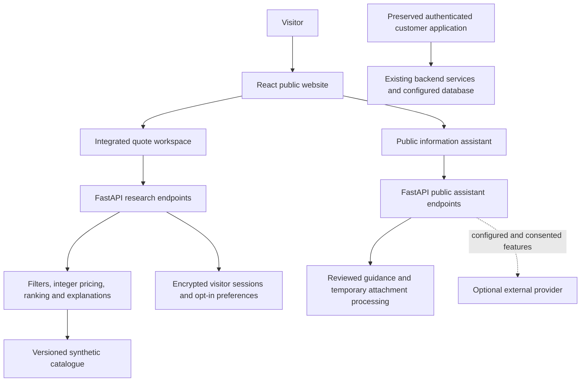

# Helm AI — Project Overview and Current Build Status

> Updated: 24 October 2026. Implementation baseline: commit `5e8596d`.
> This document describes the current repository, the product direction, delivered features, development workflow, and remaining work. It is a project handover document, not a production acceptance certificate.

## Contents

1. [Project and repository](#1-project-and-repository)
2. [What we are building](#2-what-we-are-building)
3. [Current status at a glance](#3-current-status-at-a-glance)
4. [What has been built](#4-what-has-been-built)
5. [The current user journey](#5-the-current-user-journey)
6. [Recommendation engine and synthetic data](#6-recommendation-engine-and-synthetic-data)
7. [Public chat assistant](#7-public-chat-assistant)
8. [Recent scrolling and chat improvements](#8-recent-scrolling-and-chat-improvements)
9. [Architecture and technology](#9-architecture-and-technology)
10. [Repository structure](#10-repository-structure)
11. [Local setup and running the prototype](#11-local-setup-and-running-the-prototype)
12. [Configuration and data boundaries](#12-configuration-and-data-boundaries)
13. [Testing and verified results](#13-testing-and-verified-results)
14. [What remains unfinished](#14-what-remains-unfinished)
15. [Suggested next milestones](#15-suggested-next-milestones)
16. [Working together in the shared repository](#16-working-together-in-the-shared-repository)
17. [Key references and handover checklist](#17-key-references-and-handover-checklist)

## 1. Project and repository

| Item | Current project context |
| --- | --- |
| Product name | Helm AI |
| Shared GitHub repository | [GarvGupta25/Helm_AI](https://github.com/GarvGupta25/Helm_AI) |
| Shared branch used for the current work | `main` |
| Local Git checkout used in this session | `U:\projects\Helm_AI` |
| Collaborators | Utkarsh raj and a friend, working from the same shared repository |
| Latest implementation commit at this document's baseline | [`5e8596d`](https://github.com/GarvGupta25/Helm_AI/commit/5e8596da44d6bf3411ce0d37797ec403b6e0d995) — scrolling fixes and chat composer refinement, authored by Utkarsh raj |
| Package version | Frontend, API, and root package currently identify as `0.1.0` |
| Product state | Working local demonstration and synthetic recommendation prototype |

### Relationship to the earlier project

The current working session originally opened in `U:\projects\Insurance_UAE`, which is a different Git checkout with a different remote. Helm AI was cloned separately from its own GitHub repository. Current Helm AI work belongs in `U:\projects\Helm_AI` and must be pushed to the Helm AI remote.

The Helm AI repository itself preserves code and records of an earlier UAE-oriented insurance system. The newer public experience is a UK private medical cover demonstration. Historical customer modules, backend services, migrations, and archived professional portals remain present; the entire older system has not been converted into a live UK service.

The checked-in [AGENTS.md](AGENTS.md) records the shared pull, preserve, validate, commit, and push workflow for future work.

## 2. What we are building

Helm AI is a website that helps people understand private medical cover, express their needs, compare suitable demo options, and understand the reasons behind a recommendation.

The current product direction combines:

- **Plain-English education:** explain cover, exclusions, underwriting, excess, hospital lists, and the next step.
- **Structured comparison:** turn a visitor's confirmed needs into a shortlist with server-calculated synthetic prices and explicit trade-offs.
- **Explainable recommendations:** show why an option appears, why another fails, and what changes when preferences change.
- **Conversational help:** provide a public information assistant and a separate preference-change interface within the quote journey.
- **A polished interface:** responsive pages, accessible controls, consistent typography, restrained motion, and a compact chat experience.
- **A reviewable demo outcome:** let a visitor review a synthetic selection and download a confirmation without taking payment or creating an insurance contract.

### Intended audience

The public content addresses individuals and households exploring UK private medical cover, including families, younger adults, people over 50, self-employed visitors, newcomers to the UK, and people investigating specific benefit categories. Business, adviser, and insurer information routes also exist.

These audience pages describe the demonstration's content structure. They do not mean that real products, approved advice, insurer onboarding, or live support are available.

### Current scope

Today, the product is a **fictional UK cover comparison and information demo**. Insurers, policy variants, prices, hospital networks, and evaluation personas in the recommendation system are synthetic.

The current public flow does not collect money, issue a policy, perform real underwriting, or submit an application to an insurer. Moving from this demonstration to a live insurance service requires additional product, engineering, operational, privacy, security, and approval work.

## 3. Current status at a glance

| Area | What exists today | Practical boundary |
| --- | --- | --- |
| UK public website | Shared navigation, Home, About, educational content, guides, FAQs, glossary, support/legal information, and fictional care finder | Some legal/business details remain placeholders and require review |
| Main quote journey | Integrated `/get-cover/quote` comparison using 576 synthetic variants | This is a demonstration, not a real insurer quotation |
| Recommendation explanations | Standard, Contextual, and Fusion scores; clause evidence; why/why-not; scenarios; what-if; undo | Deterministic research rules, not independently validated advice |
| Selection and confirmation | Plan review, explicit acknowledgements, persisted demo confirmation, JSON download | £0 collected; no policy, account link, or email delivery |
| Public assistant | Streaming chat, Stop, attachments, voice feature detection, session controls, Arabic/RTL, dark mode | Provider-dependent capabilities need configuration and consent |
| Interface refinement | Stable shared header geometry and navy/white/teal chat styling | Physical-device scrolling and microphone behavior still need device checks |
| Historical customer system | Authentication and policy/claims/servicing source remains present | Separate from the new synthetic selection flow; needs its existing integrations |
| Professional portals | Broker, provider, and claim-review interfaces preserved in `archive/` | Not newly deployed standalone portals |
| Verification | Build, scoped lint, unit tests, browser checks, and earlier backend reports | Automated demo results do not certify a live service |
| Live release | Explicitly blocked by the production guard | Launch blockers remain unresolved |

## 4. What has been built

### 4.1 UK public website

The active public application provides:

- A shared header, navigation menus, mobile navigation, search, and footer.
- Home and About experiences with responsive layouts.
- Cover-category and audience pages.
- Information about underwriting, claims, exclusions, and private cover concepts.
- FAQs, a glossary, guides, and a fictional care finder.
- Contact, extra-support, accessibility, privacy, cookie, and other legal-information routes.
- Cookie preferences and an external-link confirmation interface.
- Keyboard navigation, visible focus, reduced-motion handling, and responsive presentation.

The public market configuration uses `en-GB`, GBP, and `Europe/London`. Firm identity and regulatory details remain visibly unresolved in the market configuration.

### 4.2 Integrated quotation workspace

The normal **Get a quote** entry point now uses the recommendation workspace directly. Visitors do not need a separate research page or a signed-in account for this demo.

The workspace includes:

- Age, region, household counts, budget, excess, hospital-list, and benefit-priority controls.
- A distinction between hard requirements and softer preferences.
- Server-side eligibility filtering and computed prices.
- A shortlist of up to three different policy families.
- Score contributions, exclusions, clause evidence, and comparison details.
- Scenario costs and a computed what-if preview.
- Confirmed conversational preference changes, reranking, version history, and undo.
- Consent-based preference memory, export, and deletion controls.
- Selection review and a saved demo confirmation.

The earlier 30-plan public wizard is no longer the routed public quote experience. Its source and legacy API remain for compatibility. Counts describing that older catalogue should not be mistaken for the 576-variant recommendation catalogue.

### 4.3 Confirmation and downloadable record

After selecting a shortlisted plan, a visitor can review its premium breakdown, tax assumption, excess, copayment, limits, and key facts. Required acknowledgements begin unticked.

Confirmation validates the stored comparison and current profile version, checks the selected plan, and persists a receipt inside the private encrypted session. The flow includes session isolation, stale-version checks, idempotency for the same selection, and rejection of conflicting selections for the same comparison.

The downloadable JSON record includes the selected quote, policy snapshot, synthetic clauses, scores, confirmed needs, scenarios, and acknowledgement time. Refresh can restore the confirmation while the session and profile remain valid.

The receipt explicitly records that no payment, policy creation, account linking, or email delivery occurred. The current public journey ends here.

### 4.4 Preserved historical customer and professional features

The repository still contains the earlier customer application's source for sign-in and recovery, profiles, intake/conversation, marketplace quotations, activation progress, policies, coverage, documents, claims and appeals, servicing, payment schedules/receipts, nearby-care views, and Ask Helm.

Related backend services, workers, authorization, and migrations remain present. Their existence in the codebase does not mean they are configured or exercised by the isolated UK demo server.

Broker Workspace, Provider Workspace, and claim-review UI are preserved under `archive/`, with extraction notes, dependency references, manifests, and dedicated tests. Bringing them back as standalone portals requires additional entry-point, authentication, configuration, and deployment work.

## 5. The current user journey

1. **Explore:** arrive on the public website and read introductory cover information.
2. **Ask:** optionally open the public assistant for general information.
3. **Start a quote:** follow **Get a quote** to `/get-cover/quote`.
4. **Describe needs:** enter fictional household and cover preferences; identify essential benefits and strict limits.
5. **Generate recommendations:** the server evaluates the synthetic catalogue and returns up to three eligible policy families.
6. **Inspect the reasoning:** compare costs, scores, exclusions, clauses, and treatment-cost scenarios.
7. **Refine:** edit needs or review a conversational proposal, confirm changes, rerank, or undo. What-if results remain previews until their changes are confirmed.
8. **Select and review:** inspect a chosen plan's key facts and complete the acknowledgements.
9. **Confirm the demo:** save a £0 demonstration receipt.
10. **Keep a record:** download the confirmation or use the available session export controls.

Route behavior:

| Route | Current behavior |
| --- | --- |
| `/` | Public homepage |
| `/about` | About experience |
| `/get-cover/quote` | Canonical integrated recommendation and selection journey |
| `/get-cover/compare` | Redirects to `/get-cover/quote` |
| `/research` | Redirects to `/get-cover/quote` |
| `/contact` | Demo contact/support information |
| `/login` and `/app/*` | Existing authenticated customer application entry points |
| Professional broker/provider/staff entry patterns | Redirect or provide portal guidance; preserved workspaces are separate |

The public information assistant and the quote workspace's preference-change conversation serve different purposes. Public chat answers do not silently alter a confirmed quote profile.

## 6. Recommendation engine and synthetic data

### 6.1 Catalogue and reproducible datasets

The research generator is configured for:

| Dataset | Configured scope |
| --- | --- |
| Fictional insurers | 12 |
| Families per insurer | 8 |
| Excess/network variants per family | 6 |
| Total policy variants | 576 |
| Generated profiles/quotes | 10,000 |
| Chronological histories | 3,000 |
| Evaluation personas | 60 |

The generator uses a fixed seed and versioned configuration. Samples and reports are versioned; full generated exports belong under ignored `.runtime/` directories and can be regenerated.

The local demo server seeds the runtime catalogue. It does not generate all 10,000 profiles and 3,000 histories at every startup.

### 6.2 Filtering, pricing, and ranking

The engine applies age/region availability, required benefit evidence, strict budget/excess limits, validity, and hospital-list constraints before ranking. Unknown or excluded required cover cannot be treated as established coverage. If nothing qualifies, the system does not silently relax the visitor's hard requirements.

Prices and costs use integer pence and half-up rounding. The premium model and displayed tax assumption are synthetic demonstration rules, not live insurer pricing or actuarial calibration.

The ranking exposes three views:

- **Standard:** a reference assessment of the product's configured attributes.
- **Contextual:** an assessment using the current confirmed profile and requirements.
- **Fusion:** a combination of the two, using configured weights that depend on the amount of confirmed preference evidence.

The configured Standard weights are 30/20/15/15/10/10. Context weights are 25/20/15/10/10/10 and are normalized from 90 to 100. Fusion alpha values are 0.70, 0.50, and 0.30 for sparse, medium, and rich confirmed evidence. These are research assumptions rather than optimized or independently validated weights.

Up to three different families are selected in score order. This diversity rule can omit a second variant from an already selected family.

### 6.3 Explanations and simulation

The interface explains results using stored contributions, clauses, failed requirements, and counterfactual calculations. Six shared treatment scenarios distinguish eligible treatment, benefit caps, excess, copayments, and uncovered expenses.

Preview distributions use 500 deterministic shared draws; a deeper simulation endpoint supports up to 2,000. These simulations illustrate the synthetic model and are not predictions of a real customer's treatment spending.

### 6.4 Preference changes and memory

The deterministic extractor works without an external model. It proposes changes rather than silently applying them. Confirmed updates create a new profile version, rerun the engine, and allow undo.

Optional Groq extraction requires configuration and consent for that message. Its output is validated; it cannot directly set prices, scores, or eligibility. Failure falls back to the deterministic extractor.

Default session retention is 24 hours. Durable soft-preference memory requires explicit opt-in and a stable encryption key, with a configured window of up to 90 days. Current explicit needs take precedence over remembered preferences. Export, memory editing/deletion, revocation, and session deletion controls exist.

Learned ranking remains disabled. Generated-persona evaluation results measure agreement with synthetic labels, not independent proof of real customer benefit or fairness.

## 7. Public chat assistant

The new public widget implements:

- Streaming responses with a Stop control and non-stream fallback.
- Starter prompts and follow-up suggestions.
- Enter to send and Shift+Enter for multiline input.
- An automatically growing text area and a 2,000-character limit.
- Attachment consent, upload/progress/removal controls, and bounded image/PDF processing.
- Voice feature detection, consent, recording controls, and graceful error handling.
- Offline feedback, retry behavior, and request-limit feedback.
- Timestamps, delivery states, copy, local feedback, and regeneration.
- Session-only conversation restoration, new conversation, Undo, and transcript download.
- A demo human-support handoff/reference flow.
- Arabic/RTL, dark mode, reduced motion, and mobile viewport handling.
- Sanitized message rendering without executable HTML or remote Markdown images.

Conversation history is kept in browser-tab session storage, bounded to the most recent 200 messages. Raw files, audio, and object URLs are not persisted there. Server attachment processing has separate temporary-retention behavior described in the chat documentation and configuration.

Real microphone permissions, device speech services, live provider calls, camera behavior, and a deployed OCR environment require their own checks. A demo support reference does not book a callback or deliver an email.

### Widget feature flag

`VITE_NEXT_CHAT_UI=true` enables the new widget in a preview build. Development enables it by default unless explicitly set to `false`. Set the flag **before building**; changing it after producing static assets does not change the compiled UI.

The older `ChatPanel` remains as the feature-flag fallback.

## 8. Recent scrolling and chat improvements

### 8.1 Shared scrolling fix

The supplied recording showed the header snapping between its full-width and pill states. A regression test reproduced a **92px change in the page's document position** when the desktop header switched shape.

The fix in `5e8596d`:

- Keeps the shared sticky header's occupied layout space constant.
- Removes the negative-margin change that displaced the main content.
- Accumulates scroll direction over a 24px threshold instead of reacting to each small momentum event.
- Keeps the header available when its controls receive keyboard focus.
- Removes guessed offscreen section/footer heights that could move scroll anchors.
- Retains reduced-motion handling.

The new regression checks exercise Home, About, and Contact at 375px and 1280px widths, including small continued downward movement and an upward reversal. They passed after the fix. No physical-device frame-rate benchmark was recorded.

### 8.2 Chat composer redesign

The chat styling now uses deep navy, soft white, and subtle teal accents, with a navy dark-mode variant. The composer has:

- A rounded input bar with a light border and restrained shadow.
- A single shared focus ring instead of a separately outlined textarea inside the bar.
- Consistent 44px attachment, microphone, send, Stop, and recording-action buttons.
- Consistently sized icons and balanced spacing.
- Short, explicit hover/focus transitions that respect reduced motion.
- Compact disclaimer, privacy, human-support, and storage information.
- A 16px mobile input font and existing safe-area/keyboard handling.

These changes were made in the existing CSS/token system. No new UI or animation dependency was added. Chat behavior and handlers were retained, with existing interaction tests rerun.

## 9. Architecture and technology



| Layer | Current technology |
| --- | --- |
| Frontend | React 19, TypeScript, Vite 7, React Router 7 |
| UI | Existing CSS/token system, Tailwind 4 tooling, Radix primitives, Lucide icons |
| State/forms | TanStack Query, React Hook Form, Zod where used by existing modules |
| Assistant rendering | React Markdown, rehype-sanitize, existing optional dotLottie artwork |
| API | Python, FastAPI, Uvicorn, Pydantic |
| Persistence | SQLAlchemy, Alembic, PostgreSQL-compatible models/migrations; SQLite for the isolated local demo |
| Authentication | Existing Supabase integration for historical authenticated workflows |
| Research-state encryption | Fernet through `cryptography` |
| Optional AI services | Groq integration; existing LangGraph-related backend dependencies |
| Document/media tools | Existing PDF, image, OCR, and audio dependencies |
| Quality checks | TypeScript, ESLint, Vitest, Testing Library, Playwright, axe, pytest, Ruff, Lighthouse |
| Dependency installation | npm lockfiles and backend uv lockfile |
| CI | Existing GitHub Actions workflow for build, lint, backend, frontend, and browser checks |

### Main API surfaces

| Surface | Purpose |
| --- | --- |
| `/health` | API health response |
| `/api/v1/synthetic/catalogue/stats` and `/api/v1/plans` | Catalogue inspection |
| `/api/v1/research/sessions` | Create a private research session |
| `/api/v1/profile/*` and `/api/v1/conversation/message` | Validation, proposed changes, confirmed state, history, and undo |
| `/api/v1/recommendations` and its run-specific subroutes | Ranking, explanations, simulations, and what-if |
| `/api/v1/quotation/confirm` and `/api/v1/quotation/confirmation` | Save and retrieve a demo selection receipt |
| `/api/v1/memory`, `/api/v1/consent`, and `/api/v1/me` | Memory, consent, export, and deletion |
| `/api/public/assistant/*` | Streaming, attachments, transcription, handoff, and feedback |
| Existing authenticated backend routes | Preserved customer, marketplace, claims, and professional functions |

Private research state requires an `X-Research-Session` bearer capability. It is a secret and must not be included in screenshots, shared links, logs, or commits.

## 10. Repository structure

```text
Helm_AI/
├── AGENTS.md                       Shared collaboration instructions
├── README.md                       Quick project introduction and setup
├── PROJECT_OVERVIEW.md             This detailed handover document
├── package.json                    Root development and browser-test commands
├── frontend/
│   ├── src/main.tsx                 Public/customer application entry
│   ├── src/uk/                     Active UK public pages and quote workspace
│   ├── src/market/                 Public market configuration
│   ├── src/ui/                     Shared primitives, tokens, and UI tests
│   ├── src/marketing/chat/         New public chat widget and tests
│   ├── src/marketing/components/   Launcher and legacy/public components
│   └── src/CustomerApp.tsx         Preserved authenticated application
├── backend/
│   ├── app/main.py                FastAPI application and router registration
│   ├── app/research/              Synthetic data, scoring, state, and quote APIs
│   ├── app/market/                Earlier UK demo catalogue/quote support
│   ├── app/public_chat.py         Public chat transport and media endpoints
│   ├── app/public_assistant.py    Reviewed guidance and rate limiting
│   ├── app/worker.py              Existing background worker
│   ├── scripts/                   Demo server, data, and evaluation commands
│   ├── tests/                     Backend checks
│   └── migrations/                Alembic migrations
├── supabase/                       Existing configuration and SQL migrations
├── tests/uk/                       Public, quote, chat, and scrolling checks
├── tests/e2e/                      Preserved customer browser checks
├── docs/                           Research, workflow, design, and readiness reports
├── archive/                        Preserved professional UI and original snapshots
├── scripts/                        Release guard and project utilities
├── .github/workflows/              CI configuration
└── .runtime/                       Ignored local data, logs, keys, and evidence
```

## 11. Local setup and running the prototype

### Requirements

- Git and repository access.
- Node.js 22 or a compatible version.
- Python 3.12 recommended. The backend package supports Python `>=3.12,<3.14`; Python 3.14 is outside that range.
- uv for the backend environment.
- Chrome or installed Playwright browser binaries for browser tests.

### Clone and install

```powershell
git clone https://github.com/GarvGupta25/Helm_AI.git
Set-Location Helm_AI

npm ci
npm --prefix frontend ci
uv sync --project backend --locked --group dev --python 3.12
```

For an existing checkout, inspect local changes and synchronize with the shared branch before starting work. Do not clone over an existing folder or replace a collaborator's local changes.

### Start the isolated API — terminal 1

```powershell
uv run --project backend python backend/scripts/uk_test_server.py
```

This runner uses `.runtime/uk-e2e.db`, creates the UK/research demo tables, seeds the fictional catalogue, and keeps its demo encryption key under `.runtime/`. It explicitly selects the scratch database rather than the configured customer database. Catalogue preparation can take a short time before the API becomes available.

API health: [http://127.0.0.1:8000/health](http://127.0.0.1:8000/health).

### Start the development frontend — terminal 2

```powershell
npm run dev -- --port 5174
```

Open [http://127.0.0.1:5174](http://127.0.0.1:5174). The Vite proxy forwards `/api` and `/health` to port 8000. Public content can render without the API; recommendations and assistant responses need the API.

### Build and preview the new chat UI

```powershell
$env:VITE_NEXT_CHAT_UI='true'
npm run build
npm --prefix frontend run preview
```

Preview: [http://127.0.0.1:4174](http://127.0.0.1:4174). Quote page: [http://127.0.0.1:4174/get-cover/quote](http://127.0.0.1:4174/get-cover/quote).

The prototype was started on these preview/API ports during the current work. These are local services, not a hosted deployment, and must be started again after a machine or process restart. Use a free port or the existing matching service if one is already running.

### Reproduce research exports when needed

```powershell
uv run --project backend python -m app.research.generator --config backend/generator/config/synthetic_generator.yaml --output .runtime/synthetic-uk-v1
uv run --project backend python backend/scripts/research_evaluate.py
```

The full export is not required to browse the public pages. Database migration/import commands for a separately configured environment are documented in the research runbook; they are separate from starting the scratch demo.

## 12. Configuration and data boundaries

Use `frontend/.env.example` and `backend/.env.example` as references for variable names. Keep real values outside Git.

| Setting or resource | Meaning |
| --- | --- |
| `VITE_NEXT_CHAT_UI` | Selects new chat versus legacy fallback at frontend build time |
| `DATABASE_URL` | Configured backend database; overridden by the isolated demo runner |
| `SUPABASE_URL` / public anon configuration | Existing authentication integration |
| `RESEARCH_STATE_KEY` | Stable Fernet key required for durable opt-in research memory |
| `RESEARCH_LLM_ENABLED` and `GROQ_API_KEY` | Optional provider extraction; message consent is also required |
| `SYNTHETIC_ADMIN_TOKEN` | Enables the protected generation API when explicitly configured |
| `PUBLIC_UPLOAD_TTL_SECONDS` | Temporary attachment-processing retention configuration |
| Professional portal URL settings | Optional links to separately configured broker/provider/staff portals |
| `.runtime/` | Local scratch data, generated exports, logs, and keys; ignored by Git |

Do not put server keys in frontend `VITE_*` variables. Do not commit environment files, encryption keys, databases, session capabilities, uploaded documents, or dependency directories.

The synthetic quote session, public chat session, generated datasets, and historical customer records are separate kinds of data. A demo quote confirmation does not automatically become a customer policy or a training example.

The public assistant has a request limiter. Repeated browser-suite runs against the same API process can exhaust its allowance and produce HTTP 429 responses. For local verification, restart the isolated demo API between repeated runs when necessary; do not weaken the application limit merely to make tests pass.

## 13. Testing and verified results

### Latest implementation verification — 24 October 2026

The scrolling/chat implementation in `5e8596d` was checked with:

| Check | Observed result |
| --- | --- |
| Demo build, including TypeScript build check | Passed |
| Scoped frontend ESLint | Passed |
| Frontend unit tests | 10 passed |
| UK public/quote/chat/scrolling browser suite | 18 passed |
| Shared-header geometry | Stable across Home/About/Contact at 375px and 1280px in the regression checks |
| Composer behavior | Focus, aligned controls, multiline input, and send verified |
| Existing interaction coverage | Quote confirmation, streaming/Stop, offline fallback, uploads, simulated voice controls, Arabic/RTL, and responsive layouts passed |
| Automated accessibility | Existing public/research/chat checks passed in their tested states |

An initial regression run confirmed the original 92px jump. During iterative checks, one run hit the demo request limit and a new geometry assertion sampled the opening animation. The API was restarted, the layout assertion was made deterministic with reduced motion, and the final full run passed all 18 checks.

Verification logs and screenshots from this session were retained locally under ignored `.runtime/`. The tracked evidence directories contain earlier repository evidence; do not assume every checked-in screenshot/report was regenerated for this revision.

### Earlier repository verification

The dated [research verification report](docs/research/VERIFICATION.md) records earlier backend, customer-browser, fixture-evaluation, and accessibility results. Its reported full backend result was 401 passed with one pre-existing skip. That historical suite was not rerun as part of the latest CSS/header change or this documentation task.

Earlier Lighthouse scores are dated local measurements. They should not be presented as fresh measurements of the latest revision or as production performance guarantees.

### Useful check commands

Run these as appropriate to the change; a documentation-only edit does not require rerunning every application test.

```powershell
$env:VITE_NEXT_CHAT_UI='true'
npm run build
npm run check
npm --prefix frontend run lint:uk
npm --prefix frontend test
npm run test:uk
npm run test:e2e

uv run --project backend ruff check backend/app backend/tests backend/scripts
uv run --project backend pytest backend/tests -q

python archive/verify_preservation.py
git diff --check
```

The browser configuration can start missing preview/API services. It can also reuse existing local services, so confirm they point at the intended checkout and build. The UK suite writes screenshots and reports into tracked documentation directories; review those changes separately and avoid accidentally committing unrelated generated output.

### Verification still requiring external or manual work

Physical mobile scrolling/GPU behavior, actual mobile keyboards and cameras, real microphone/provider permissions, manual screen readers, independent Arabic wording review, live PostgreSQL concurrency, live provider calls, and real insurer/payment integrations are not established by these browser checks.

## 14. What remains unfinished

### 14.1 Live product and business configuration

- Confirm the real firm identity, contact details, regulatory scope, and approved public wording.
- Replace fictional products with approved real product data and contractual documents if a live product is pursued.
- Obtain appropriate business, legal, privacy, and distribution approvals.
- Complete product governance, advice/suitability decisions, and customer-understanding research.

### 14.2 End-to-end service beyond the demo confirmation

- Define and implement the transition from confirmed needs to an actual application.
- Integrate real underwriting, insurer acceptance, and issuance where required.
- Implement account linking and a consistent customer policy record.
- Add approved payment handling, receipts, and delivery processes.
- Connect email/documents and actual support operations.

These capabilities are not completed merely because related legacy models or screens exist in the repository.

### 14.3 Historical-system migration

- Complete the domain/data migration of retained older contracts, agents, payment paths, and professional workflows.
- Decide which archived professional portals should become separate products and how they will be hosted.
- Validate existing authorization and data boundaries in the intended new environment.
- Preserve historical records and restoration artifacts while migration is planned and reviewed.

### 14.4 Quality, operations, and independent evaluation

- Test physical devices, assistive technology, keyboard/zoom behavior, and the complete user journey manually.
- Re-measure current mobile performance and establish field monitoring for any hosted release.
- Validate PostgreSQL execution/concurrency, deployment configuration, distributed request limiting, backups, and retention operations.
- Review processor/transfer arrangements and schedule approved data-cleanup operations.
- Evaluate recommendation usefulness with independent human evidence rather than generated labels alone.

### Live-release guard

```powershell
npm --prefix frontend run build:production
```

This command intentionally fails while live-release blockers remain. The ordinary demo build is allowed; it is not a substitute for launch approval. The detailed checklist is [LAUNCH_READINESS.md](docs/uk/LAUNCH_READINESS.md).

## 15. Suggested next milestones

The following is a proposed sequence for discussion, not a claim of approved scope or completed implementation.

| Milestone | Intended outcome | Evidence needed |
| --- | --- | --- |
| 1. Agree the next product scope | Decide whether the next release is a portfolio demo, research prototype, or a step toward a live service | A written scope and acceptance criteria |
| 2. Complete interface/device QA | Confirm the scrolling and chat experience on real target devices | Device checks, manual accessibility findings, current performance measurements |
| 3. Define post-confirmation behavior | Decide what should happen after the existing demo receipt | Reviewed journey and data contracts before integration work |
| 4. Plan historical migration and portal ownership | Decide what to retain, migrate, extract, or keep archived | Migration plan, integration boundaries, restoration plan |
| 5. Build approved integrations | Connect only the services required by the agreed scope | Integration tests and reviewed environment configuration |
| 6. Prepare any live release | Resolve the readiness checklist and operational responsibilities | Required independent checks and explicit release sign-off |

## 16. Working together in the shared repository

Both collaborators use [GarvGupta25/Helm_AI](https://github.com/GarvGupta25/Helm_AI) as the source of truth. Start with the latest shared work and push completed changes so the other collaborator can obtain them.

### Before work

```powershell
git remote -v
git status --short --branch
git fetch origin
git pull --ff-only
```

Inspect local changes first. A failed fast-forward pull is a signal to review divergence, not to reset or overwrite another person's work. Preserve local changes and coordinate overlapping edits.

### During work

- Confirm the target repository before editing; `Insurance_UAE` and `Helm_AI` are separate checkouts.
- Read `AGENTS.md` and relevant implementation/runbook files.
- Preserve a collaborator's changes and keep commits focused on the task.
- Use the existing stack and dependencies when they solve the problem.
- Keep production databases, credentials, and synthetic scratch data separate.
- Run checks proportionate to the change and report actual results.

### Finish and push

```powershell
git diff --check
git status --short
git add <explicit-files-for-this-task>
git commit -m "Describe the completed change"
git fetch origin
git pull --rebase origin main
git push origin main
git status --short --branch
```

This finish sequence assumes a committed, clean local state on `main`. If the remote advanced, review and resolve integration issues, then rerun any affected checks before pushing. Never force-push shared history. If a push is blocked, explain the blocker rather than claiming the work is available remotely.

Use the actual contributor's Git identity. Utkarsh's work in this checkout is currently configured with the author name **Utkarsh raj**. Another collaborator should use their own identity.

Changes requested to the process should also be reflected in `AGENTS.md`. Update this overview when the delivered scope, main user journey, setup requirements, or verified status materially changes.

## 17. Key references and handover checklist

| Reference | Use it for |
| --- | --- |
| [README.md](README.md) | Quick entry, setup, and project links |
| [AGENTS.md](AGENTS.md) | Shared repository instructions |
| [QUOTE_WORKFLOW.md](docs/QUOTE_WORKFLOW.md) | Canonical quote, selection, receipt, and post-confirmation boundaries |
| [Research README](docs/research/README.md) | Generator, ranking, memory, APIs, phases, and assumptions |
| [Research verification](docs/research/VERIFICATION.md) | Dated earlier test results and their limitations |
| [Chat design notes](docs/chatbot-design-notes.md) | Widget behavior, feature flag, styling, and verification boundaries |
| [Launch readiness](docs/uk/LAUNCH_READINESS.md) | Detailed remaining live-release blockers |
| [UK phase reports](docs/uk/PHASE_REPORTS.md) | Historical implementation checkpoints |
| [Performance/accessibility report](docs/uk/PERFORMANCE_ACCESSIBILITY_REPORT.md) | Dated measurements and outstanding checks |
| [Archive README](archive/README.md) | Preserved workspaces, extraction notes, and restoration context |
| [Archive manifest](archive/MANIFEST.md) | What was moved or preserved during the earlier split |

Some older phase and archive documents describe an earlier branch state or a proposed separate `/research` page. For current routing, use `frontend/src/main.tsx`, `frontend/src/uk/PublicApp.tsx`, and `docs/QUOTE_WORKFLOW.md`. Treat older reports as dated history when they conflict with the present implementation.

### Start-of-session checklist

- [ ] Confirm the remote is `GarvGupta25/Helm_AI`.
- [ ] Read `AGENTS.md`, inspect local changes, and fetch shared updates.
- [ ] Confirm whether the task concerns the current public demo, research engine, historical customer system, or an archived portal.
- [ ] Use the isolated API for demo work unless a different environment is explicitly required.
- [ ] Enable `VITE_NEXT_CHAT_UI=true` before preview builds of the redesigned widget.
- [ ] Keep proposed future capabilities distinct from features that already exist.

### End-of-session checklist

- [ ] Finish the authorized scope and run appropriate checks.
- [ ] Review changed files, generated evidence, and any configuration changes.
- [ ] Update relevant documentation when behavior changes.
- [ ] Commit intended files under the correct contributor identity.
- [ ] Integrate new shared updates and push the finished commits.
- [ ] Report the resulting commit, check results, and material remaining limitations.
