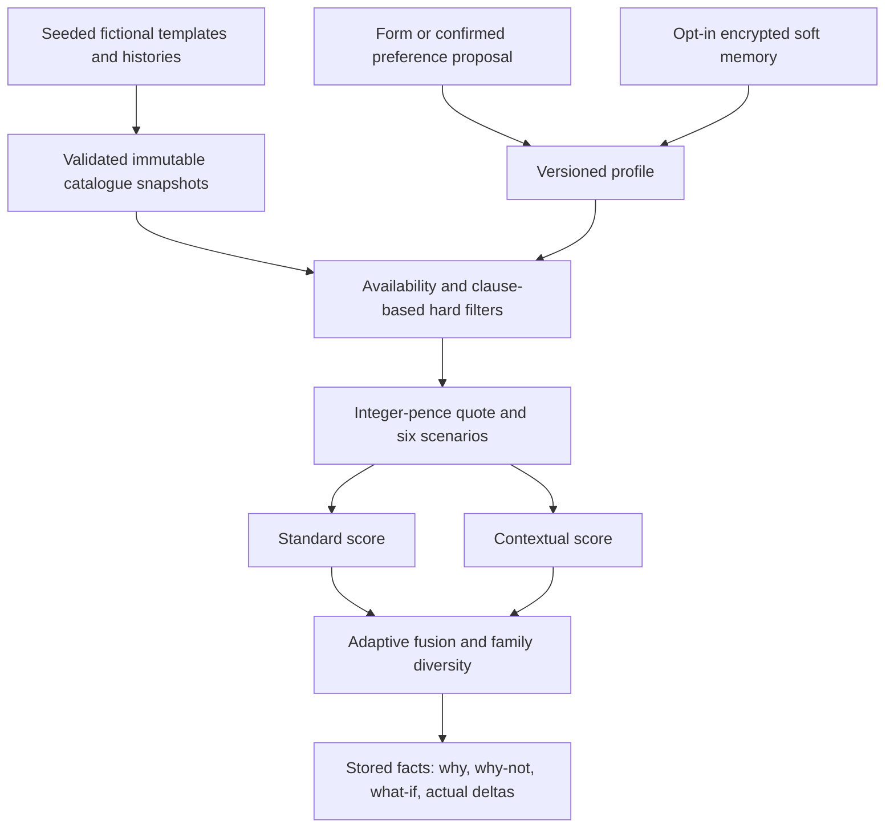

# UK synthetic recommendation research

The recommendation engine now powers the normal **Get a quote** journey at `/get-cover/quote`. `/research` and `/get-cover/compare` redirect there; no separate research page is required. Public information chat and authenticated customer workflows remain separate. No generated product is available for sale. No real insurer catalogue, patient history or provider network is used.

## Run locally

Use the root README's isolated demo setup. `backend/scripts/uk_test_server.py` creates only UK/research tables in `.runtime/uk-e2e.db`, seeds the catalogue and keeps its test encryption key in ignored `.runtime/research-test.key`. It never connects to the configured customer database. Open `/get-cover/quote` with `npm run dev`.

To reproduce the full experimental exports:

```powershell
uv run --project backend python -m app.research.generator --config backend/generator/config/synthetic_generator.yaml --output .runtime/synthetic-uk-v1
uv run --project backend python backend/scripts/research_evaluate.py
```

The configuration is JSON-compatible YAML, avoiding a second parser. `generated_at` is a fixed **fixture epoch** for reproducibility; the quality report records the actual validation execution time. Dataset samples, the 60-persona corpus and quality/evaluation reports are checked in here; full generated profiles/histories/quotes remain in ignored `.runtime/synthetic-uk-v1`. Do not mix visitor state into these exports.

For a separately configured database, back it up and apply the additive migrations with `uv run --project backend alembic -c backend/alembic.ini upgrade head`, then run `uv run --project backend python backend/scripts/research_data.py --import-dir .runtime/synthetic-uk-v1`. The import validates references and rejects mutation of an existing catalogue snapshot. A new incompatible catalogue version requires a separate namespace/database; historical run snapshots retain their original policy facts.

## Architecture and calculations



The physical SQL design uses `research_record` for individually addressable immutable catalogue/insurer/family/clause/hospital snapshots and `research_session` for encrypted, bounded visitor state. Logical histories/profiles/quote tables are separate generated JSON/CSV exports. This snapshot design reuses SQLAlchemy/Alembic and avoids coupling generated training records to actual visitors. Ingestion enforces logical references; these are not one relational SQL table per exported entity. PostgreSQL-compatible migrations exist; local execution was tested with SQLite, not a live PostgreSQL service.

Prices are wholly invented: age multiplier 1.018 per year above 18, London multiplier 1.20, adults + 0.35 × children, benefit-template base, excess discount and a labelled 12% IPT assumption. All displayed premiums and cost arithmetic use integer pence and half-up rounding. None of these factors is actuarially calibrated.

Standard scores use 30/20/15/15/10/10 component weights and an age-35 England reference quote. Context uses 25/20/15/10/10/10, renormalized from 90 to 100. Dialogue and memory are preference evidence, **not additional additive benefit rewards**. Alpha is .70/.50/.30 for sparse/medium/rich current confirmed evidence. These are explicit research hypotheses. Missing components are renormalized separately from completeness.

Required unknown/excluded cover cannot pass as established coverage. Existing-condition requests cannot be made eligible by a headline benefit. Strict budget/excess, region/age, validity and hospital-tier requirements filter before ranking. Up to three different families are selected in score order. There is no silent relaxation; this diversity rule can omit another variant of a selected family. Learned ranking and automated dominance pruning are disabled.

Six shared scenarios distinguish eligible treatment, benefit caps, excess, copay and uncovered expense. Annual premium plus scenario cost is shown separately. Preview distributions use 500 deterministic shared draws; the deeper simulation endpoint supports up to 2,000. Equal scenario weights are artificial, not population utilization probabilities. P90 is not a contractual ceiling, a forecast or a US out-of-pocket maximum.

## Intent, explanations and memory

The deterministic ontology extractor works without a provider. It proposes changes, preserves other required benefits when adding/retracting a preference and asks about ambiguity. Confirmed updates create a profile diff, rerun the same engine and calculate actual rank/score differences. API confirmation is bound to a hash of the reviewed message and the current profile version; it does not rerun an external model and accept a new proposal silently. Form edits are drafts until confirmed. Undo restores the prior snapshot.

Optional Groq extraction needs `RESEARCH_LLM_ENABLED=1`, a configured `GROQ_API_KEY` and consent on that message. Provider JSON is schema/ontology validated and cannot set prices/scores/eligibility. Invalid output, unavailable credentials or provider failure falls back to the deterministic extractor. Provider tests use mocks; no live extraction was used for verification. Grounded XAI uses stored score contributions, clauses, failures and counterfactual calculations. It does not need an LLM or SHAP to explain weighted arithmetic.

Session-only state expires after 24 hours by default and uses a process-ephemeral encryption key unless `RESEARCH_STATE_KEY` is configured. Durable memory is disabled without a stable Fernet key. With one, explicit opt-in can retain confirmed soft preferences for up to 90 days; training consent remains off and cannot be enabled. Current explicit needs win. Reused soft memory decays to zero over its validity window and can change contextual scores by less than three points at default weights. Clicks and saves remain feedback, not unquestioned inferred requirements. Export, editing/deleting memory, consent revocation and whole-session deletion are supported.

Use TLS and store a stable deployment key outside the database/repository. Back it up securely; changing it makes existing state unreadable. Old unencrypted development sessions are rejected and must be replaced. Run `research_data.py --purge-expired` on an operator-controlled schedule. This command is implemented; no scheduler was installed on the user's machine.

## APIs and operational controls

`/api/v1` exposes catalogue stats/plans, profile validation/extraction/history/update/undo, confirmed conversation changes, recommendations/runs/why/why-not/what-if/explain-chat, feedback, memory controls, consent, export/delete, model cards and evaluation summary. Research state requires the random `X-Research-Session` bearer capability; a run from another session is inaccessible. Never publish this capability.

Generation is normally a CLI. `POST /api/v1/synthetic/generate` is disabled without a `SYNTHETIC_ADMIN_TOKEN` and requires its bearer token. It produces bounded local exports only, not a public catalogue write. Administrator import remains explicit. Catalogue endpoints never fetch real products or use client-supplied scores.

The existing live-production release guard remains closed. No hosting deployment, real transactions, clinical assurance or regulated brokerage approval was performed.

## Phase delivery and limits

| Phase | Delivered checkpoint | Evidence / qualification |
|---|---|---|
| 0 | Inventory, architecture and scope separation | `docs/phase0_report.md` |
| 1 | Seeded fictional catalogue, 10,000 profiles/quotes, 3,000 longitudinal histories, 60 personas, JSON/CSV exports | Generator tests, quality report, dataset samples |
| 2 | Isolated SQL snapshots/migration, ingestion validation, clause/availability/hard filters | API and filter tests; PostgreSQL execution remains unverified |
| 3 | Integer pricing, caps/excess/copay, six scenarios, 500/2,000 draws | Hand-vector and monotonicity tests |
| 4 | Standard engine, component contributions and missingness | Arithmetic and stable-reference tests |
| 5 | Current contextual fit and explicit constraints | Coverage/strict-limit property cases |
| 6 | Adaptive fusion, family-diverse top three, no-fit and sensitivity values | Fusion/reproducibility tests; no claim of optimized weights |
| 7 | Typed proposals, optional schema-validated provider, confirmation, diffs and undo | Mock-provider, correction and exact-confirmation tests |
| 8 | Grounded why/why-not, comparison, evidence and computed what-if | Clause-reference checks and browser flows |
| 9 | Encrypted opt-in explicit memory, precedence, decay, export/revocation/deletion | Encryption, provenance, isolation and current-priority tests |
| 10 | Optional learned model intentionally disabled | No independent incremental-value evidence; baseline retained |
| 11 | Responsive research workspace and accessible public widget | Browser screenshots and axe reports |
| 12 | Generated-persona evaluation, privacy/security controls and adversarial tests | Reported fixture metrics; not independent human validation |
| 13 | CI checks, reproducible runbooks, model/limitations documentation | Code pushed to main; no external hosting deployment or production sign-off |

Implemented: deterministic demo, opt-in memory, optional extraction integration and UI/API controls. Synthetic by design: insurers, prices, service metrics, networks, users, interactions and persona labels. Disabled/conditional: learned reranker, live provider calls without consent/configuration. Unverified/external: real-device speech and screen readers, independent preference labels/fairness audit, live PostgreSQL execution, real-world calibration and any production compliance approval.

The generated-label NDCG/Hit metrics establish agreement with a template clause/price oracle only. They are not independent proof of recommendation relevance, customer benefit, learned preferences or fairness. The original UK transformation's remaining live-release and legacy-data blockers remain in `docs/uk/PHASE_REPORTS.md` and `LAUNCH_READINESS.md`; this research extension does not make those complete.

The canonical quotation and post-selection workflow is documented in [QUOTE_WORKFLOW.md](../QUOTE_WORKFLOW.md), including the explicit limits after demo confirmation.
