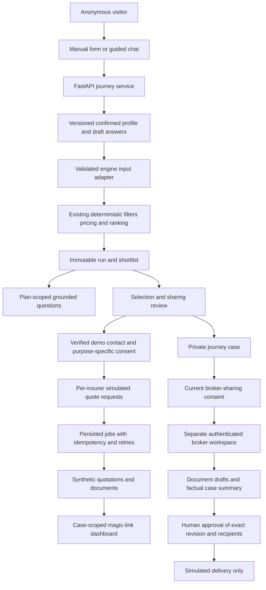
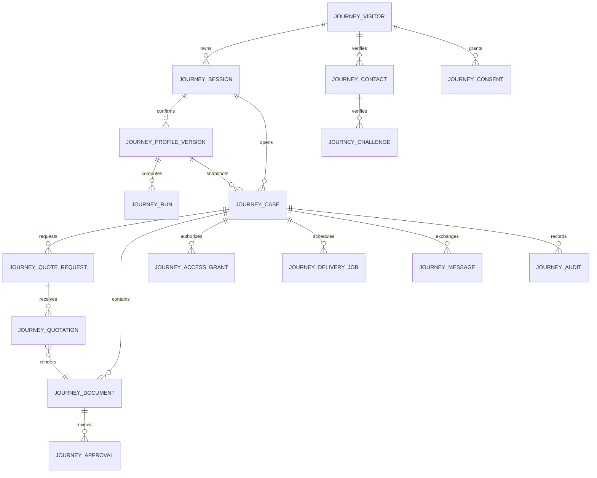
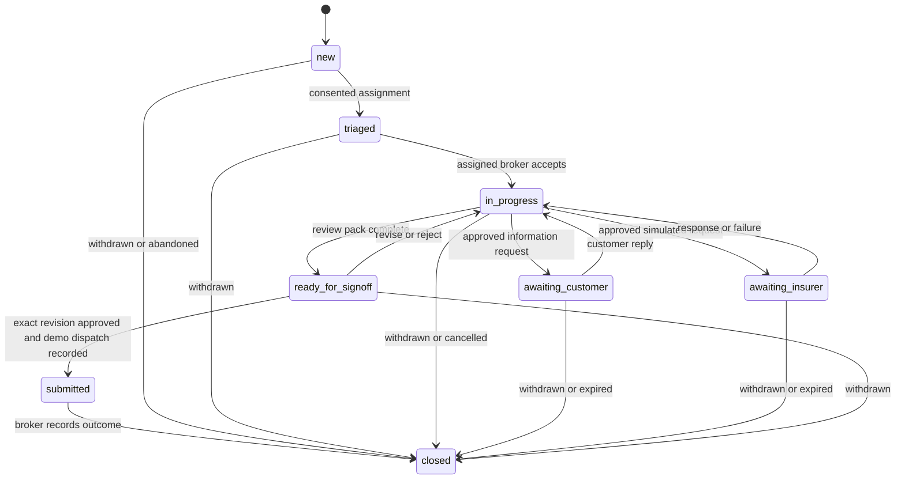

# Helm AI: intake-to-broker journey — Phase 0 plan

**Date:** 24 October 2026  
**Repository:** [GarvGupta25/Helm_AI](https://github.com/GarvGupta25/Helm_AI)  
**Audited baseline:** `bac8de4` on `main`  
**Author for this work:** Utkarsh Raj  
**Status:** Phase 0 plan ready for owner approval. Phases 1–6 have not started.

**Execution update:** The owner subsequently authorized proceeding phase by phase without asking for approval at every boundary. Development may proceed through Phases 1–6 using the proposed demo defaults. Reports and meaningful commits remain required; human approval of application-generated artifacts and the prohibition on live integrations remain unchanged. The original gate language below records the planning baseline.

## 1. Scope, gates, and decisions to approve

The supplied master prompt defines a synthetic journey from shared manual/chat intake through recommendations, policy questions, simulated insurer quotations, a private dashboard, and assigned-broker review. It explicitly requires: **“Phase 0 is planning only. Write no application code until I approve it.”** It also requires a report and approval after each subsequent phase.

This deliverable changes documentation only. It does not restore a portal, run migrations, enable a provider, change authentication, or send messages. The 15-commit request is a delivery requirement across the approved development phases, not a reason to make artificial documentation commits or bypass approval gates.

### Recommended architecture decisions

| ID | Proposed decision | Reason / consequence |
| --- | --- | --- |
| D1 | Keep the journey inside this repository and backend; introduce an isolated `journey_*` namespace | Reuses the stack without putting anonymous visitors into legacy customer tables |
| D2 | Keep `/get-cover/quote` as the public entry; manual and guided-chat modes use one confirmed server profile | Switching modes must never reset confirmed or unconfirmed captured answers |
| D3 | Add draft intake sessions that do not run recommendations automatically | Today's research session creation requires a complete engine profile and immediately runs the engine |
| D4 | Reuse deterministic pricing/filtering/ranking through an explicit, tested input adapter | The LLM never determines eligibility, prices, scores, or scenario arithmetic |
| D5 | Build a small separate broker frontend entry, selectively reusing archived UI patterns | The archive expects legacy member IDs, AED helpers, and different case contracts; wholesale restoration would couple unrelated domains |
| D6 | Use visitor/contact identities and case-scoped magic access before optional Supabase account linking | Contact verification is not the same thing as a signed-in customer account or broker role |
| D7 | Default dashboard links to 24 hours; allow a reviewed 48-hour configuration | Link validity must not silently exceed the underlying authorized case/data retention period |
| D8 | Create a private case at selection-review confirmation; release it to a broker only after explicit broker-sharing consent | Meets automatic handoff intent without disclosing data merely because a plan card was clicked |
| D9 | Keep customer-facing conversational guidance deterministic by default; human approval gates LLM-authored prose and documents | A literal human-approval rule conflicts with unrestricted instant LLM replies; see section 4 |
| D10 | Use local simulation adapters and persisted delivery jobs; add no third-party dependency initially | No real email, WhatsApp, payment, insurer request, or paid service setup is authorized |
| D11 | Keep the existing live-release guard closed throughout these phases | Demo completeness does not resolve the repository's live-launch blockers |

### Owner decisions needed at the Phase 0 gate

1. **Human approval:** approve the interpretation in section 4: deterministic reviewed prompts/answers may display immediately; LLM prose remains a draft until broker approval. Schema-bound captured-field proposals are shown as an explicitly unconfirmed review interface, not accepted facts. If even displaying those proposals requires prior broker review, keep external extraction disabled until that review queue exists.
2. **Family pricing:** approve versioned fictional family eligibility terms and the deterministic multi-person rating work in Phase 2. Until that is implemented, unsupported family profiles receive a clear limitation; they are never collapsed into a single adult and described as individually eligible.
3. **Handoff trigger:** approve D8 and a separate broker-sharing consent. Early broker requests without verified contact remain private requests until consent/contact prerequisites are satisfied.
4. **Magic access:** approve a 24-hour default, with 48 hours available only when the case retention and consent permit it. A dashboard is case access, not automatic account creation.
5. **Broker environment:** approve a separate entry in this repository using the existing Supabase broker role. A local configured test identity service or test-only dependency overrides are needed to verify authenticated flows; missing auth must fail closed.
6. **Contact and scope:** approve fake contact destinations and local delivery previews only. Named live vendors, purchased services, and actual message delivery remain separate future approvals.
7. **Missing prompt sections:** the supplied attachment ends at Phase 6 and refers to “Cross-cutting” and “Compliance notes” sections that are absent. This plan proposes those contracts explicitly; it does not assume missing Phase 7+ requirements or authority to launch.

Approval starts **Phase 1 only**. At each phase boundary, report the concrete changes, actual checks, limitations, and proposed next phase, then wait for the owner's next approval.

## 2. Audit: existing code versus the requested journey

The required starting documents were read: [AGENTS.md](../../AGENTS.md), [PROJECT_OVERVIEW.md](../../PROJECT_OVERVIEW.md), [QUOTE_WORKFLOW.md](../QUOTE_WORKFLOW.md), [research README](../research/README.md), [archive README](../../archive/README.md), and [launch readiness](../uk/LAUNCH_READINESS.md). The audit also inspected the implementation and tests listed below.

| Capability | Current evidence | Gap / reuse decision |
| --- | --- | --- |
| Public quote route | `frontend/src/uk/PublicApp.tsx`, `Research.tsx` | Preserve the route and public shell; add intake modes before the existing comparison |
| Profile schema | `backend/app/research/schemas.py::Profile` | Uses defaults, one adult age, household counts, constraints, and evidence. No per-person ages, start date, smoking answer, switching status, or underwriting-choice field |
| Profile capture | `Research.tsx` holds a local form; comparison creates/updates the research session | A visitor can currently recommend using preset values; defaults are not evidence of an answered intake field |
| Session creation | `research/router.py::create` | Immediately runs the engine. Add a separate draft-session lifecycle; do not break existing research clients |
| Confirmation/versioning | `apply_profile`, `conversation`, `undo`, `profile/history` | Reuse semantics. Existing manual updates do not require an expected-version precondition; add it for new journey writes |
| Session capability | `research/router.py::own`, `research/models.py` | Existing 43-character capability is also the session primary key. Preserve compatibility; new journey sessions store capability digests, not raw bearer tokens |
| State encryption | `research/storage.py::EncryptedState` | Reuse the existing Fernet implementation with a stable key for durable data; add key/retention runbooks rather than another encryption scheme |
| Ranking and costing | `research/engine.py` | Reuse Standard/Contextual/Fusion, integer pence, clauses, scenarios, and family diversity. Current family quote uses one adult age and counts, so additional persons need explicit treatment |
| Intent extraction | `research/intent.py` | Existing provider may propose only a small preference-field allowlist. Expand against the canonical schema; do not let it set arbitrary fields or overwrite existing hard needs |
| Demo receipt | `/api/v1/quotation/confirm`, `/quotation/confirmation` | Already checks profile/run selection, acknowledgements, idempotency, and synthetic clauses. Preserve this £0 receipt; a new multi-insurer request is a separate record |
| Policy explanation | Plan-detail clauses and run-specific why/why-not/simulation/explain-chat endpoints | Good source facts exist; no bounded per-policy conversation with a 50-question citation evaluation is yet delivered |
| Public assistant | `marketing/chat/`, `public_chat.py`, `public_assistant.py` | Reuse safe rendering, composer, transport patterns, and controlled guidance. Do not turn public chat history into intake or broker records implicitly |
| Current handoff | `/api/public/assistant/handoff` | Produces a demo support reference; it is not an assigned broker case, contact service, or notification inbox |
| Customer auth | `frontend/src/api.ts`, `backend/app/auth.py` | Reuse server-verified Supabase identity and administrator-controlled `app_metadata.helm_role`; never trust client-supplied roles |
| Broker assignment | `models.py::BrokerAssignment`, `services.py::assigned` | Existing assignment is member-account based. A new guest case needs a case-specific assignment and current sharing consent |
| Broker workspace | `archive/broker-workspace/` | Preserved extraction kit, not a bootable standalone app. Reuse queue/review patterns selectively; retain archived originals |
| Public broker routes | `frontend/src/main.tsx` | Current broker/provider/staff entry patterns redirect. Do not undo this globally just to expose a new portal |
| Existing marketplace | `marketplace_broker.py`, `marketplace_models.py` | Contains useful explicit checkpoint/idempotency patterns but uses legacy applications/providers/contracts. Keep separate from new synthetic journey records |
| Existing customer/claims services | Customer application, claims, servicing, worker, Supabase migrations | Leave behavior and data intact. No implicit policy creation, financial events, or health-record migration from a demo quote |
| Persistence and migrations | Alembic `0001_uk_additive`, `0002_research`; existing Supabase SQL history | Add new migrations; do not rewrite applied migrations or run blanket archive restoration |
| Release guard / limiter | `scripts/uk-release-guard.mjs`, `public_assistant.py` | Preserve live-build failure and existing request limits; extend protection to new endpoints without weakening old ones |

### Preserve compatibility deliberately

- Existing `/api/v1` research and confirmation behavior remains available while the new `/api/journey` contract is introduced.
- Start new visitors in the new journey model. Offer an explicit import of an owned existing research profile only after verifying its capability and showing what will be copied.
- Copy a snapshot, not a live reference to mutable historical visitor data. Never manufacture verified contact, sharing consent, broker assignment, or account ownership during import.
- Preserve the existing 18 public/quote/chat/scrolling browser regressions and historical customer checks; label any intentional test updates.
- Do not change the existing synthetic catalogue in place when introducing new family or underwriting terms. Historical receipts/runs retain their original facts.

## 3. Target architecture and portal decision

### Broker portal: selective reuse, separate entry

Proposed location: `broker/` in the same repository, containing a small React/Vite app that points to the same backend. It gets its own bootstrap, login/role boundary, build output, and local port. Deployment hosting is a later decision; no new Git repository or public deployment is created by this plan.

Reuse existing React, Router, Query, Supabase client setup, icons, and shared design tokens where appropriate. Selectively adapt queue, detail, review, and loading/error patterns from the archive. Keep `archive/broker-workspace` byte-preserved; do not run `restore.sh` or copy the archive's complete old dependency tree/styles into the public app.

This is a small new entry with reused components, not a wholesale rewrite of all professional features. Legacy appeals, policy reassessments, provider consoles, and claim-review screens remain outside this journey. New endpoints use case assignment and consent, not the legacy member-based `assigned()` join.

### Implementation seams, not a new framework

Use ordinary FastAPI routers, Pydantic models, SQLAlchemy services, existing Fernet storage, existing ReportLab, and Python functions/classes for the few adapters. Reuse the worker's leasing/idempotency ideas with journey-specific job types; do not invoke legacy payment/claims jobs. No event bus, vector database, new agent framework, or new UI library is required for this scope.

## 4. Human approval and AI boundaries

The statement “Every AI-drafted output that reaches a customer or insurer needs a human approval step” needs an explicit operating interpretation before Phase 1.

**Proposed conservative implementation:**

1. Prewritten, reviewed interview questions and deterministic fact-to-text policy explanations may display immediately. They are controlled templates, not freshly generated LLM prose.
2. An optional extractor produces schema-bound **proposals** only. The UI shows a limited field diff with evidence, not freeform provider prose. The visitor confirms or edits before the canonical profile changes. Approval of this review-interface interpretation is an explicit Phase 0 decision.
3. Any LLM-authored policy reply, case letter, email, insurer submission, or customer document is a private draft. It cannot appear to its external audience before an authorized human approves the exact revision. For customer/insurer-facing prose, that approver is the assigned broker.
4. Approval records bind artifact ID, content hash, profile version, catalogue/run version, purpose, named recipients, approving broker, and timestamp. Editing content, recipients, or the relevant profile invalidates approval.
5. The worker checks current approval, contact verification, consent, and case access again at execution time. A UI button or a model-generated `approved=true` is never authority.
6. Deterministic PDF generation from approved structured facts does not authorize dispatch. Sharing review and the applicable human approval remain separate gates.
7. Draft factual summaries may be shown internally to the assigned broker with source references and an “unreviewed” label; forwarding them requires approval.

If literal pre-display review is required even for extracted-field chips, Phase 1 uses the deterministic interviewer only; external extraction remains disabled until a broker review path is delivered. No exception is inferred from the request for an AI chat mode.

## 5. Canonical intake profile

### 5.1 Model and classification

Use one versioned `JourneyProfile` for both modes. An incomplete draft is valid storage, but not automatically a valid recommendation input. Each confirmed change creates a new immutable version; undo creates another version referring to an earlier snapshot rather than erasing history.

The server separates three concepts:

- **Captured value:** may be an unconfirmed form edit or extraction proposal.
- **Confirmed value:** a visitor-confirmed value with provenance and version.
- **Completeness:** computed server-side from applicable confirmed fields; UI defaults never count as an answer.

In the table: **M** = mandatory for recommendations, **R** = recommended but does not by itself block the current demo, **O** = optional. **Conditional M** blocks only when its parent choice applies. Missing fields use `null`/unanswered status, never fabricated defaults. A recorded “no preference” or “not sure” is distinct from missing data.

### 5.2 All proposed business fields

| Field | Type / bounds | Hard requirement or preference | Completeness and validation | Why ask? |
| --- | --- | --- | --- | --- |
| `people` | Array, 1–8 members, bounded to current supported 1–2 adults and 0–6 children unless scope changes | Household facts | M; require at least one adult; unsupported compositions fail clearly | Establish who the demo concerns |
| `people[].id` | Server-issued stable UUID | Identity within this household | Server-managed | Preserve a person's answers when modes/order change |
| `people[].relationship` | `lead_adult`, `partner`, `child` | Fact | M; exactly one lead adult | Distinguish adult and child rules |
| `people[].age_years` | Integer 0–85 or `null` | Eligibility fact | M, unless a valid DOB is supplied; adults 18–85, children 0–17 | Apply supported age rules and synthetic rating |
| `people[].date_of_birth` | ISO date or `null` | Alternative eligibility fact | O; accept instead of age, not an additional requirement; reject future/inconsistent dates | Optional alternative to an age answer |
| `people[].smoker_status` | `yes`, `no`, `unknown`, `prefer_not_to_say`, or `null` | Sensitive declared fact, not a benefit preference | R for recommendations; explicit health-processing consent before capture; not a factor in the current engine | Capture a question for an eventual reviewed quotation without inventing an answer |
| `location.region` | England, London, Scotland, Wales, Northern Ireland, or `null` | Eligibility fact | M unless supported postcode mapping establishes a region and the visitor confirms it | Check geographical availability |
| `location.postcode` | Bounded UK-format string or `null` | Location fact | O alternative/addition; validate format; do not infer London from an unsupported lookup | Optional location precision |
| `household.adults` / `household.children` | Derived integers | Facts | Server-derived from `people`, never independently editable counts | Keep form/chat/engine counts consistent |
| `cover.start_date` | ISO date or `null` | Requested timing | M; not before quote date; proposed demo maximum 365 days ahead; engine uses pinned effective dates | Check date validity instead of assuming immediate cover |
| `cover.existing_cover` | `none`, `switching`, `renewing`, `unknown`, or `null` | Fact | R; no premium effect until explicitly modeled | Give the broker switching context |
| `cover.underwriting` | `moratorium`, `full_medical`, `no_preference`, `unknown`, or `null` | Soft preference by default | R; explain uncertainty, never imply approval | Compare available underwriting descriptions |
| `cover.underwriting_required` | Boolean | Hard only if explicitly confirmed | Conditional M when an underwriting preference is provided; unknown cannot be a hard selection | Distinguish a preference from an exclusion filter |
| `budget.monthly_pence` | Integer 0–1,000,000 or `null` | Soft target or hard limit | Conditional M when `budget.choice=amount`; GBP entered as decimal, normalized to pence without float arithmetic | Compare affordability under the synthetic model |
| `budget.choice` | `amount`, `no_target`, or `null` | Explicit visitor choice | M; no-target is a valid confirmed answer | Avoid inventing a budget |
| `budget.strict` | Boolean | Hard when true | Conditional M for an amount; no silent relaxation | Control the maximum acceptable premium |
| `excess.max_pence` | One of 0, 25,000, 50,000 or `null` for current catalogue | Soft target or hard limit | Conditional M for `excess.choice=amount`; reject unsupported values rather than rounding them silently | Set the amount the visitor is willing to contribute |
| `excess.choice` | `amount`, `no_preference`, or `null` | Explicit visitor choice | M | Distinguish unanswered from flexible |
| `excess.strict` | Boolean | Hard when true | Conditional M for a numeric limit | Preserve an explicit ceiling |
| `hospital_list.minimum_tier` | 1, 2, or `null` | Hard minimum when requested | Conditional M when choice is `minimum_tier`; do not downgrade | Check hospital-list scope |
| `hospital_list.choice` | `minimum_tier`, `no_preference`, or `null` | Requirement or flexibility | M | Record the visitor's access choice |
| `outpatient.minimum_annual_pence` | Nonnegative integer within configured catalogue bounds or `null` | Soft unless explicitly required | R; missing is not zero cover requested | Compare outpatient cover levels |
| `outpatient.required` | Boolean | Hard when true | Conditional M if a nonzero outpatient minimum is supplied | Prevent a headline outpatient flag from bypassing a numeric minimum |
| `benefits.required` | Unique array of current `CARE` enum, maximum 11 | Hard | M as an explicit choice, including an explicitly confirmed empty list | Record must-have benefits |
| `benefits.preferred` | Unique array of current `CARE` enum, maximum 11 | Soft | O; disjoint from required; changing one need preserves the others | Rank desirable benefits |
| `health.existing_condition_scenario` | `yes`, `no`, `prefer_not_to_say`, or `null` | Sensitive scenario fact, never a diagnosis | O; affirmative processing consent required before capture; unknown cannot establish cover | Demonstrate existing-condition limitations with minimal detail |

`CARE` currently contains: inpatient, diagnostics, outpatient, mental_health, physio, cancer, dental, maternity, emergency, chronic, and pre_existing. Do not collect diagnosis narratives, medication lists, medical documents, identity numbers, income, or bank/card details in this intake phase. A must-have health-related benefit can itself be sensitive context; obtain the stated processing permission before accepting that section, and explain how to continue without supplying it.

### 5.3 Envelope, evidence, and consent

| Field | Contract |
| --- | --- |
| `schema_version` | Server-owned version, initially proposed `journey-profile-v1` |
| `profile_version` | Increasing integer; all mutations require `expected_version`; stale updates return 409 |
| `source` | `manual`, `guided_chat`, `confirmed_import`, or `undo`; no authority to override server-owned fields |
| `evidence[path]` | Source, confidence, confirmed flag, confirmation time, and bounded/redacted evidence reference; LLM confidence is not visitor confirmation |
| `field_status[path]` | `unanswered`, `draft`, `proposed`, `confirmed`, or `declined`; server-validated transitions |
| `completeness` | Computed missing mandatory paths, recommended gaps, unsupported combinations, next questions; never accepted from a client as authority |
| `as_of` / `catalogue_version` / `engine_version` | Pinned by the server when creating a run; included in immutable run/quotation snapshots |
| `health_processing_consent_id` | Separate explicit statement, purpose, data categories, timestamp, wording version, and revocation record |
| `external_processing_consent` | Per-message opt-in, off by default; scoped to the exact message and provider/purpose; not inherited from memory consent |
| Contact, notification, insurer-sharing, broker-sharing, and durable-memory choices | Separate purpose-specific records; not part of the pricing profile and never inferred from “Get recommendations” |

Draft answers are saved separately from the confirmed snapshot inside encrypted session state. A mode switch changes presentation only. Confirming a form diff or chat proposal follows the same version-checked server operation. Recommendations use only the last confirmed profile, and the UI must show when newer draft answers are still pending.

### 5.4 Recommendation completeness behavior

“Recommend me” stays reachable in both modes. It first submits applicable draft answers for review, then calls server completeness validation. If something mandatory is missing, return a structured list with field path, label, reason, and focus target; offer “Answer in chat” and “Go to form.” Ask one or two missing questions at a time. Recommended gaps are disclosed without pretending they are hard failures.

No name, email, WhatsApp number, account, diagnosis, or marketing opt-in is required to view a synthetic shortlist. Contact verification becomes mandatory only for a persisted request/delivery/handoff requiring contact.

### 5.5 Engine compatibility and family support

Map the new confirmed profile to a strictly validated engine input. Do not remove the existing `research.schemas.Profile` fields or rewrite historical receipts.

- A supported single-adult profile must reproduce current pricing/scoring vectors when the catalogue, rating date, and relevant preferences match.
- New start-date validity, numeric outpatient requirements, and hard underwriting choices must be implemented as explicit server filters; merely collecting the fields is not enforcement.
- For multi-person quotes, Phase 2 proposes summing individually computed adult age contributions, retaining a clearly labeled fictional child-loading rule, and applying explicit versioned family/child eligibility clauses. Child ages must not be tested against the catalogue's adult-only 18–85 range.
- Approve the exact deterministic family formula and catalogue revision before claiming family support. Until then, preserve captured household answers but return an explicit unsupported-family result instead of a misleading recommendation.
- New catalogue facts get a new immutable version and version-qualified keys/snapshots. Existing `research_record.id` values are not a safe place to overwrite a second catalogue version: current IDs do not include the version.
- Missing coverage, waiting-period, or family eligibility evidence remains unknown. It cannot be supplied by an LLM or replaced with a favorable default.

## 6. Canonical data model and migrations

### 6.1 Proposed logical ER model

The following entities are proposed, not implemented. Existing `research_*`, customer, marketplace, and Supabase auth tables remain separate.

### 6.2 Minimum relational contracts

| Entity / proposed table | Minimum fields and constraints |
| --- | --- |
| `JourneyVisitor` / `journey_visitor` | UUID, nullable unique verified `auth_user_id`, created/expiry/deletion state. Never use a phone/email or research capability as the public ID |
| `JourneySession` / `journey_session` | UUID, visitor FK, unique capability digest, encrypted draft/proposal state, latest confirmed version, expiry, schema version; no raw capability at rest |
| `JourneyProfileVersion` / `journey_profile_version` | UUID, session FK, unique `(session_id, version)`, immutable encrypted canonical snapshot, schema/source/confirmed time, previous-version reference, non-sensitive integrity hash |
| `JourneyRun` / `journey_run` | UUID, profile-version FK, encrypted immutable inputs/results, version-qualified catalogue snapshot, engine config digest, pinned rating date, creation time. Random run IDs are metadata, not ranking inputs |
| `JourneyContact` / `journey_contact` | UUID, visitor FK, channel, encrypted normalized destination, keyed lookup digest, verification time, current delivery preferences/quiet hours/time zone, revoked time |
| `ContactChallenge` / `journey_challenge` | Contact FK, keyed OTP digest, purpose, expiry, attempt/send counters, consumed time. No OTP/destination in application logs |
| `JourneyConsent` / `journey_consent` | Visitor/session/case scope as applicable, purpose, named recipient IDs, minimized field scope, wording version/hash, affirmative time, withdrawal time, expiry if applicable; immutable consent events |
| `JourneyCase` / `journey_case` | UUID, visitor/session/profile/run references, state, version, trigger, selected plan snapshots, nullable assigned broker user ID, current broker-consent reference, encrypted minimal summary/questions/notes, retention/expiry. Unique selection-trigger key prevents duplicate automatic cases |
| `QuoteRequest` / `journey_quote_request` | UUID, case/profile/run references, insurer ID, frozen selected plans for that insurer, sharing-consent reference, reviewed payload hash, idempotency key, request state, adapter type/version. Unique case/insurer/request-key; max three selected plans checked server-side |
| `Quotation` / `journey_quotation` | Request FK, plan/version reference, immutable insurer response snapshot, integer-pence price/tax/terms, received/expiry time, document FK. Unique adapter response key |
| `JourneyDocument` / `journey_document` | Case FK, immutable revision, artifact type, encrypted content or protected storage key, hash, source/profile/quotation versions, AI-drafted flag. Stored objects are private; no public media URL |
| `HumanApproval` / `journey_approval` | Document/revision/hash, relevant profile/run references, decision, broker identity, recipient/purpose scope, time, superseded/revoked state. No client-created approving identity |
| `AccessGrant` / `journey_access_grant` | Unique token digest, case/contact FK, kind `magic_link` or `dashboard_session`, parent grant where exchanged, scope, expiry, consumed/revoked time, authority expiry. One table, distinct non-interchangeable token purposes |
| `DeliveryJob` / `journey_delivery_job` | Nullable case/contact references for OTP jobs, bounded kind, encrypted minimal payload, destination reference, scheduled time, unique dedupe key, state, attempts, lease/backoff fields, sanitized result, approval/consent references when required |
| `CaseMessage` / `journey_message` | Case FK, server-derived sender identity/role, encrypted bounded body, linked approved artifact when AI-authored, timestamp. Broker-only notes and customer-visible messages have explicit audiences |
| `JourneyAudit` / `journey_audit` | Aggregate/case reference, actor, action, before/after versions or states, timestamp, correlation ID, redacted evidence references. Do not log transcripts, contacts, capabilities, OTPs, or document content |

Use existing `ResearchRecord` catalogue facts for the initial compatible single-person adapter. Freeze the exact facts used in each run/document. A new family catalogue must have version-qualified identifiers and explicit import validation before activation; no duplicate ID mutation. A generic document table covers policy snapshots, quote PDFs, and drafts, avoiding separate tables for each document type.

Policy Q&A history remains bounded browser-session state keyed by case/session, plan, profile version, and catalogue version. Only a visitor-approved flagged question is copied into the broker case. Draft proposals stay bounded encrypted session data; no separate generic “AI memory” database is needed.

### 6.3 Additive migration plan

| Phase | Migration intent |
| --- | --- |
| 1 | Add visitor, draft-session, profile-version, and run storage; nullable fields and explicit missing states. Register metadata for migrations/tests without renaming existing models |
| 2 | Add version-qualified snapshot/catalogue support needed by approved multi-person rules; validate immutable versions and old/new arithmetic compatibility |
| 3 | No persisted conversation table by default. Add only bounded case-question transfer support when cases arrive |
| 4 | Add contacts, OTP challenges, consents, private cases, quote requests, quotation/documents, approval records, minimal delivery-job persistence, and audit. Core authorization must exist before any dispatch endpoint is enabled |
| 5 | Add access grants and notification scheduling fields/indexes; do not silently lengthen research-session retention |
| 6 | Add case assignment/message fields and state constraints/indexes; preserve case ownership and audit history. Reuse broker auth, not legacy member assignments |

Chain new Alembic revisions after the existing head; inspect the actual head before each change. Preserve applied Supabase SQL history. New tables are reachable through the API only; do not grant browser Data API access by default. If browser-accessible Postgres policies become necessary, add explicit deny-by-default RLS and assignment/consent tests before enabling access.

Test migrations on an empty scratch SQLite database and upgrade from a baseline fixture; test real PostgreSQL constraints/locking before claiming PostgreSQL concurrency support. No live database migration is authorized by approving this plan. Roll back application routing/flags first; destructive downgrades that delete new data require a separate reviewed backup/restore action. Do not run `Base.metadata.create_all()` against a configured customer database as a migration substitute.

## 7. Identity, contacts, dashboard access, and retention

### Identity progression

1. **Anonymous session:** random capability returned once, stored in browser-tab session state; database stores its digest. It authorizes that journey only.
2. **Verified demo contact:** normalize email or E.164-style phone, then consume a purpose-bound OTP challenge. Local preview inboxes use fake destinations and are explicitly simulated verification, not evidence of real contact ownership.
3. **Dashboard access:** issue a case-scoped link to the verified contact using the demo notifier. Exchanging it consumes the link and creates a short-lived dashboard session with limited capabilities.
4. **Optional account link:** later, a server-verified Supabase user proves ownership of both the case access and the verified contact. Never link accounts merely because an email string matches. Account creation/linking is not required for this demo journey and does not grant a broker role.

Keep the existing research capability and new journey identity distinct. Do not enable Supabase anonymous sign-ins just to create guest records; that changes identity/RLS behavior unnecessarily. Supabase's official documentation distinguishes anonymous auth users from public/anon access and describes verified identity linking; any future use must be reviewed against the existing role policies ([Supabase users](https://supabase.com/docs/guides/auth/users), [anonymous sign-ins](https://supabase.com/docs/guides/auth/auth-anonymous)).

### OTP and magic-link controls

- Bound challenges to destination, purpose, session, and attempt/send windows. Use keyed digests for low-entropy OTPs, short expiries, secure randomness, uniform error responses, and replay protection. No hardcoded universal verification code outside isolated tests.
- Keep the current limiter intact; add endpoint-specific budgets for OTP sends/checks, contact changes, link resend, token exchange, and broker message delivery. Production-grade shared rate storage remains a launch requirement.
- Magic links use at least 32 random bytes, hashed storage, one purpose, explicit scope, revocation, and server-clock expiry. Never put contact, medical facts, or document contents in the URL.
- Prefer a token in the URL fragment, consumed by a dedicated no-analytics/no-third-party landing page, POSTed for exchange, and removed with `history.replaceState`. Add `Referrer-Policy: no-referrer`, `Cache-Control: no-store`, and log redaction. The existing marketing shell must not load before exchange.
- A link is single-use for exchange; the resulting dashboard session may make repeated authorized reads until its own expiry. A consumed link cannot be exchanged again. This distinction is part of the required reuse tests.
- Resend requires contact reverification, revokes previous links, and does not disclose whether a contact exists. Link scanners must not consume a grant through an automatic GET.
- Use HttpOnly, same-site cookies for dashboard sessions, Secure in HTTPS environments; enforce same-origin/CSRF protection for mutations. Do not use account auth cookies as dashboard bearer grants.

### Retention and withdrawal

Keep anonymous intake at 24 hours by default. At a consented, verified request boundary, create an independent case snapshot and a clearly disclosed case-retention period (proposed demo maximum seven days, pending owner approval). An allowed 48-hour link must be covered by that period; it does not extend raw research or chat retention.

Before each read, write, export, job execution, and document download, check current scope, expiry, revocation, and applicable consent. Broker-sharing withdrawal immediately blocks broker reads/messages/delivery, revokes relevant access, and cancels queued jobs; it does not erase an audit event pretending no prior action occurred. Minimize residual audit records and explain that already delivered material cannot be recalled. A purge command/job, key-rotation handling, and deletion propagation across documents/backups need explicit acceptance tests and an approved retention policy before live use.

## 8. Selection, insurer requests, and delivery rules

Selection and confirmation are distinct from dispatch:

1. Store up to three selected plan snapshots from a current owned run. What-if-only, expired, ineligible, or stale selections are rejected.
2. Show a sharing review: exact profile fields, selected fictional insurers, broker choice, channels, and the actual demo payload.
3. Verify the selected contact; record separate insurer-sharing and broker-sharing consent as applicable. A dashboard-only preference still requires a verified recovery contact for this requested flow.
4. Create a private case idempotently when the selection review is confirmed. A case can exist before a broker is allowed to see it.
5. Group selected plans by insurer and create **one QuoteRequest per selected insurer** with plan IDs for that insurer. Three plans from the same insurer must not cause three duplicate insurer requests.
6. Only the execution service can invoke the simulated adapter after rechecking consent, snapshot version, approval where applicable, and the request's idempotency state.
7. Return deterministic synthetic quotations after a persisted `due_at`, including timeout/partial/failure cases. Never sleep inside a web request or use volatile timers as the only scheduler.
8. Keep request, received quotation, document revision, notification, and case status separate. A failed email does not turn a received quotation into an insurer failure.

Minimum request states: `draft → awaiting_verification/awaiting_consent/awaiting_approval → queued → dispatched_demo → received`, with explicit `partial`, `failed`, `cancelled`, and `expired` outcomes as applicable. Store per-plan response outcomes for partial insurer responses. Retries are bounded and idempotent; changed profile/recipients require a new reviewed payload.

The notification job stores a generic template identifier and case/document references, not raw profile data or health information in the message body. A fake inbox is a protected local demo surface, not application console output containing tokens and personal data. Reminder timing respects the contact time zone, quiet hours, opt-out, document/link expiry, and current sharing consent. Reminder jobs are persisted, deduplicated, cancellable, and safe to rerun.

## 9. Broker case state machine and access

### State machine

`submitted` means **simulated dispatch**, never real insurer submission or policy issuance. Display that wording explicitly. Closing requires a reason; reopening is not implicit and would require an explicit audited transition if later approved.

### Transition invariants

- Every transition uses an expected case version, checks current authority, and appends an audit event transactionally. Workers cannot skip review states.
- `new` may be private/unassigned. Triage or assignment requires current broker-sharing consent and a verified contact for a contactable case. No all-broker unassigned queue exposes names, contact, or profile facts.
- Initially use an administrator-configured default broker identity, not an unreviewed automatic matching algorithm. If none is configured, keep the case private and show an honest pending-assignment state.
- Queue, detail, search counts, notes, messages, downloads, notifications, and direct-ID endpoints all filter by assigned broker and current consent. Role checks alone are insufficient.
- `ready_for_signoff` requires current profile/quotations, required documents, unresolved-question disposition, and an explicit completeness checklist.
- Moving to `submitted` requires an approval of the exact outgoing revision/purpose/recipients, rechecked current consent, and a demo-delivery result. No unconditional status PATCH can authorize dispatch.
- Approval/revocation races and duplicate worker claims require transactional locking/version constraints; do not claim these are proven by SQLite alone.

### Broker experience

The workspace contains a scoped multi-client queue with status, urgency, expiry, search, and pagination; a case detail with hard limits versus preferences and provenance; selected/shortlisted plans and reasons; quotations; verified contact/channel choices; consent status; approved customer messages; private notes; flagged questions; and a versioned document/review area.

Case summaries are assembled from stored facts with source references. Any AI-drafted narrative is labeled unreviewed and remains internal until the broker approves it. The broker can edit, reject, regenerate, and approve; regeneration creates a new revision rather than mutating an approved document. Existing customer policy binding/payment/claims actions are not added to this queue.

## 10. Proposed API list

All rows below are **proposed new endpoints**, not claims of current implementation. Use `/api/journey` to avoid breaking `/api/v1` research and legacy `/api/broker` routes. Apply response-size bounds, typed errors, ownership checks, and no-store behavior where appropriate.

| Phase | Method / path | Scope and behavior |
| --- | --- | --- |
| 1 | `POST /api/journey/sessions` | Create anonymous draft session without recommendation; return capability once |
| 1 | `GET /api/journey/profile` | Owned confirmed profile, pending draft, version, completeness |
| 1 | `PATCH /api/journey/intake/draft` | Save bounded manual/chat draft answers with draft revision; no implicit confirmation |
| 1 | `POST /api/journey/intake/proposals` | Deterministic/optional consented extraction; return allowed diff/review reference |
| 1 | `POST /api/journey/profile/confirm` | Confirm exact reviewed diff against expected version; same path for both modes |
| 1 | `POST /api/journey/profile/undo` | Create a new confirmed version from a prior owned snapshot |
| 1 | `GET /api/journey/profile/history` | Bounded profile history without exposing other sessions |
| 1 | `POST /api/journey/intake/completeness` | Missing mandatory/recommended paths and next questions; no scoring |
| 2 | `POST /api/journey/recommendations` | Current complete confirmed profile only; create immutable versioned run |
| 2 | `GET /api/journey/runs/{run_id}` | Owned stored result; show stale state honestly |
| 2 | `PUT /api/journey/shortlist` | Bounded selections tied to current owned run/profile; max three |
| 2 | `POST /api/journey/runs/{run_id}/what-if` | Preview only; no mutation or selectable request until confirmation |
| 3 | `POST /api/journey/runs/{run_id}/plans/{plan_id}/questions` | Owned run/plan, bounded question; cited deterministic answer or pending draft |
| 3 | `POST /api/journey/runs/{run_id}/plans/{plan_id}/flag-question` | Explicit visitor-reviewed broker question; retains plan/profile references |
| 4 | `POST /api/journey/contacts/challenges` | Rate-limited fake OTP delivery job for normalized destination |
| 4 | `POST /api/journey/contacts/verify` | Consume purpose-bound challenge; record simulated verified state |
| 4 | `POST /api/journey/consents` | Record an explicit purpose/recipient/field scope and wording version |
| 4 | `DELETE /api/journey/consents/{consent_id}` | Withdraw consent, revoke/cancel affected future access/jobs |
| 4 | `POST /api/journey/quote-requests` | Review/version/idempotency checks; create private case and per-insurer request set |
| 4 | `GET /api/journey/quote-requests/{request_id}` | Owned status and partial/failure outcome |
| 5 | `POST /api/journey/access-links` | Verified scoped request/resend; protected fake delivery, no raw token in logs |
| 5 | `POST /api/journey/access-links/exchange` | Consume link; create restricted dashboard cookie/session |
| 5 | `POST /api/journey/dashboard/logout` | Revoke dashboard session; CSRF/same-origin checks |
| 5 | `GET /api/journey/dashboard` | Authorized case dashboard, quotations, freshness, expiry, and safe contact summary |
| 5 | `GET /api/journey/quotations/{quotation_id}/document` | Authorized streamed private PDF with no-store and safe filename |
| 5 | `PATCH /api/journey/notification-preferences` | Verified owner preferences, quiet hours, opt-out; audit/cancel affected jobs |
| 6 | `POST /api/journey/broker-requests` | Early handoff intent; collect missing prerequisites without disclosure |
| 6 | `GET /api/journey/broker/cases` | Server-verified broker; assigned/consented queue only |
| 6 | `GET /api/journey/broker/cases/{case_id}` | Same authority for detail and all subordinate resources |
| 6 | `POST /api/journey/broker/cases/{case_id}/transitions` | Allowed transition, expected version, reason, transaction/audit |
| 6 | `POST /api/journey/broker/cases/{case_id}/notes` | Broker-private bounded note |
| 6 | `GET/POST /api/journey/cases/{case_id}/messages` | Verified owner or assigned consented broker; audience-specific output |
| 6 | `POST /api/journey/broker/cases/{case_id}/documents/drafts` | Create bounded deterministic/optional AI draft, never dispatch |
| 6 | `POST /api/journey/broker/documents/{document_id}/approvals` | Broker decision on exact revision/hash/recipient set |
| 6 | `POST /api/journey/broker/documents/{document_id}/dispatch-demo` | Revalidate approval, consent, authority, version, and idempotency |
| Cross-cutting | `GET/DELETE /api/journey/me` | Owned export/deletion with retention, withdrawal, and job cancellation rules |

Reuse existing health/config/auth discovery rather than duplicating it. A case owner cannot choose the approving broker or elevate a token scope through a request body. Administrative case assignment is initially an operator-managed configuration/CLI, not a new public admin API.

## 11. Providers and demo substitutes

| Capability | Existing tool / future external need | Default for these phases |
| --- | --- | --- |
| Intake extraction / document drafting | Existing Groq SDK and server configuration | Deterministic extractor/templates and fixture provider; external processing off unless separately configured and consented; human approval still applies |
| Per-policy retrieval | Structured catalogue facts and clause text | Direct bounded lookup; no vector store or embeddings needed for 576 small synthetic variants |
| Insurer requests | Real insurer APIs would require agreements and authentication | `SimulatedInsurerAdapter` with a small typed request/result contract, persisted delay, idempotency, and timeout/partial fixtures |
| WhatsApp | Future Meta WhatsApp Business Platform or approved intermediary | Protected fake inbox with opt-in/template/window state simulation; no network send |
| Email | Future approved transactional provider/SMTP arrangement | Local fake inbox with delivery states; no real addresses needed |
| PDF generation | Already installed ReportLab | Deterministic server rendering of stored synthetic facts; no new PDF library |
| Document storage | Existing local file/DB infrastructure; private object storage later | Protected local `.runtime` storage with authorization on every read; tests use temp directories |
| Broker identity | Existing Supabase Auth | Existing configured local Supabase for manual integration QA; isolated dependency overrides in automated tests only; no browser “demo broker” bypass |
| Customer magic access | New application-scoped grant exchange | Random digested grants and fake delivery, separate from Supabase account access |
| Delays/reminders | Existing SQLAlchemy/worker techniques | Database-backed due jobs and explicit runner/clock; no new scheduler service/dependency |

For any future live WhatsApp setup, verify opt-in, approved templates, delivery/opt-out handling, escalation, and the customer-service window against the current [WhatsApp Business Messaging Policy](https://business.whatsapp.com/policy). The policy distinguishes template-based business initiation and messages within the 24-hour customer-service window. A 48-hour dashboard link does **not** extend that messaging window. These phases simulate those constraints; they do not establish an approved live messaging account.

## 12. UI/UX plan

Retain the recent deep navy, soft white, and subtle teal composer palette, existing Inter typography and Instrument Serif marketing accents. UI/UX Pro Max's local lookup was consulted; generic newsletter, playful-block, font, and scroll-snap suggestions do not fit this application's established insurance workflow and are not adopted. Reuse the actual project's tokens/primitives.

- **Intake:** accessible radio/tabs for “Fill it in myself” and “Let the AI ask me”; shared progress/summary panel and one sticky action within the viewport. Draft/confirmed states must be visible without color alone.
- **Small screens:** one-column fields, collapsible summary, no bottom action obscuring controls/keyboard. Preserve 44px actions and 16px editable input text.
- **Guided chat:** one or two unanswered fields at a time, explicit hard/soft labels, “Why we ask,” proposed-field chips, edit/confirm controls, and recovery after provider failure. No fake typing delays or claims that a broker is online.
- **Comparison:** at most three columns on desktop; scrollable labeled comparison or stacked summaries on mobile; no hidden loss of exclusions/terms.
- **Policy questions:** a drawer or panel anchored to the plan, visible policy/version context, source links, suggested questions, unknown-answer route, and broker flag action.
- **Contact/consent:** review named recipients and actual shared fields, separate optional channels and broker consent, unticked choices, clear simulated-delivery labels.
- **Dashboard:** pending/received/partial/expired states, available downloads, comparison, link expiry/recovery, and broker contact. Avoid sensitive information in generic notification previews.
- **Broker workspace:** dense but readable queue/detail layout with scoped counts and explicit review states; approve/reject/changes controls identify the exact document revision.
- **Accessibility:** keyboard order, focus restoration, labeled errors, restrained live regions, RTL, dark mode, reduced motion, 200–400% zoom checks, and no scroll-position jumps. Browser automation supplements rather than replaces screen-reader/device verification.

## 13. Risk register and compliance questions

These are design risks and review responsibilities, not a legal compliance determination. No real financial, insurance, or medical transaction is authorized.

| ID | Risk | Required control / evidence | Owner or gate |
| --- | --- | --- | --- |
| R1 | Demo described or used as a regulated live advice/submission service | Keep synthetic labels and release guard; no real requests/payments; review intended permissions/activities before changing scope | Product owner + qualified compliance/legal review |
| R2 | Health-related intake collected without valid permission/minimization | Separate explicit purpose-specific consent, minimal fields, withdrawal path, no raw diagnosis collection; documented legal basis/condition review before live use | Privacy owner; Phase 1 schema gate |
| R3 | “AI assistant” bypasses human sign-off | D9 interpretation; draft-only provider prose; exact-revision approval rechecked at delivery | Owner approval now; Phase 6 tests |
| R4 | Family support falsely inferred from one adult's age | Per-person capture, explicit unsupported states, versioned deterministic family rules/clauses before claims of eligibility | Owner rating decision; Phase 2 |
| R5 | New intake fields collected but ignored in hard filters | Field-to-engine mapping and negative tests for start date, underwriting, outpatient limits, and hard benefits | Phases 1–2 |
| R6 | LLM guesses benefits, prices, terms, or eligibility | Allowlisted proposals; grounded answer records; deterministic scenario calls; 50+ policy-question evaluation including unknowns and injection attempts | Phase 3 |
| R7 | Wrong-account linking or another visitor's case exposed | Verified subject plus case capability/verified-contact proof; no email-string merges; ownership/IDOR tests on every endpoint | Phases 4–6 |
| R8 | Broker role grants access to every guest | Per-case assignment and active sharing consent on queue, count, detail, document, note, and message paths | Phase 6 blocker |
| R9 | Contact OTP/link guessing, replay, leakage, scanners | Keyed OTP digests, random grant digests, expiry/revocation, purpose scopes, rate limits, safe exchange page, no token/PII logs | Phases 4–5 |
| R10 | Duplicate insurer requests or conflicting approvals under concurrency | Unique keys, expected versions, transaction locks, outbox leases; real PostgreSQL concurrency checks before external claims | Phases 4–6 |
| R11 | Notification sent after withdrawal/quiet hours or with stale approval | Recheck before execution; cancel/dedupe jobs; generic templates; approved recipient and payload versions | Phases 5–6 |
| R12 | Retention mismatch between 24-hour intake and a 48-hour link | Explicit independent case retention, bounded authority expiry, purge tests; no automatic extension of research state | Owner D7/retention decision |
| R13 | Legacy restoration damages original customer behavior or archive evidence | Selective UI reuse, additive tables/routes, no blanket restore or data copy, preservation/customer regression checks | All phases |
| R14 | Access/health content leaks through metrics, logs, exports, or storage | Redacted audits, private documents, minimal hashes/references, no raw provider-error logging, export/delete access tests | All phases |
| R15 | Browser-only tests treated as real-device/accessibility assurance | Explicit device/screen-reader checklist and honest evidence report; preserve scroll regressions | Each UI phase |
| R16 | New providers/dependencies broaden scope or create cost | Demo adapters only; written justification before dependency; separate explicit approval before live integrations | Owner |
| R17 | Missing attachment sections hide required data/compliance constraints | Record unanswered questions and confirm schema/state/retention in this plan before implementation | Phase 0 approval |

The [FCA's insurance-distribution perimeter guidance](https://handbook.fca.org.uk/handbook/perg5) covers activities including arranging and advising; the project must not infer that a disclaimer or free access settles the regulatory perimeter. The [ICO's special-category processing guidance](https://ico.org.uk/for-organisations/uk-gdpr-guidance-and-resources/lawful-basis/special-category-data/what-are-the-conditions-for-processing/) explains the specificity and explicit statement expected when relying on explicit consent. Those sources inform the review questions above; this plan does not select a legal basis or certify compliance. Sources were consulted on 24 October 2026 and must be rechecked before any live scope change.

## 14. Phase-by-phase acceptance and reporting

### Phase 0 — audit and architecture

**Deliver:** this audit, decisions, canonical schema, ER model, migrations, case states, provider choices, APIs, risk register, phase checks, and commit roadmap.

**Acceptance:** source references exist; current versus proposed behavior is clearly distinguished; no application code/migration/configuration is changed; documentation links/fences and whitespace checks pass; plan is committed/pushed under Utkarsh Raj. **Gate:** owner approves the plan and resolves or accepts the documented defaults before Phase 1.

### Phase 1 — shared manual/guided intake

**Build:** draft sessions; canonical validation/completeness/provenance; version-checked confirmation and undo; manual/guided modes; bounded reviewed questions/proposals; health/external-processing consent; persistent draft preservation; responsive progress and missing-field actions. Keep unsupported family/field combinations explicit until Phase 2 support is delivered.

**Required checks:** schema boundaries; missing versus default versus declined values; exactly-one age/DOB consistency; health consent and no-provider-without-consent; extraction outage/invalid JSON/injection/allowlist; identical confirmed snapshots from equivalent form/chat answers; stale-update rejection; mode-switch/draft persistence; undo; keyboard/RTL/focus and scoped axe; existing public/customer regressions affected by routing. **Gate:** report actual results and limitations; wait for approval of Phase 2.

### Phase 2 — recommendations and exploration

**Build:** canonical-to-engine adapter, approved versioned family/date/underwriting/outpatient rules, pinned replay inputs, persistent shortlist/remove, three-plan comparison, clear why/why-not, and what-if history. Reuse existing weights and family diversity; do not silently relax hard constraints.

**Required checks:** single-adult price compatibility; family hand vectors and declared child limitations; integer rounding; all hard-filter paths; immutable catalogue/runs; replay deterministic item values for the same version/time/config; no-fit; duplicate/overflow shortlist; stale/what-if selection rejection; browser comparison and edit/undo flows. **Gate:** report and wait for Phase 3 approval.

### Phase 3 — plan-specific questions

**Build:** bounded plan/profile/catalogue-scoped conversation, structured-fact and clause retrieval, deterministic scenario tool calls, citations, starter questions, unknown-answer fallback and explicit broker flag. LLM prose stays draft-only under section 4.

**Required checks:** at least **50 versioned policy questions** with expected factual fields/clauses, plus unanswerable, conflicting-version, unsupported waiting-period, adversarial/injection, cross-session, and arithmetic cases. Every factual claim in released controlled answers maps to a stored field/clause; out-of-data questions refuse rather than guess. Cover sanitized rendering, history bounds, mobile/RTL/focus, and no profile mutation. **Gate:** report and wait for Phase 4 approval.

### Phase 4 — selection, contact, and simulated requests

**Build:** max-three plan review; exact share payload; fake verified contact with bounded OTP; separate insurer/broker consent and notification preferences; private case creation; per-insurer request grouping; minimal job/approval infrastructure; simulated insurer response states, document snapshots, and idempotency.

**Required checks:** stale/foreign/unowned plans; contact format/OTP send and attempt budgets/replay/expiry; affirmative consent wording/recipients/revocation; request grouping and concurrent idempotency; approval bypass; timeout/partial/retry cases; no outbound network provider calls; private-case access denied before assignment/consent. **Gate:** report and wait for Phase 5 approval.

### Phase 5 — delivery and private dashboard

**Build:** fake WhatsApp/email adapters; digested access grants and controlled exchange; 24-hour default/approved 48-hour option; dashboard statuses/comparison/private PDF downloads; persisted reminders; resend/reverification/revocation and friendly expiry recovery. Attach policy Q&A to frozen quotation facts rather than silently using a newer catalogue.

**Required checks:** expired/replayed/revoked/cross-case/wrong-purpose grants; repeated authorized dashboard-session reads; document authorization and no-store; safe filenames; delivery and opt-out/quiet-hour states; reminder dedupe/cancellation; link/data retention relationship; sanitized logs; scanner-safe exchange; token absent from analytics/referrers and no sensitive URL payloads. **Gate:** report and wait for Phase 6 approval.

### Phase 6 — broker handoff, workspace, and sign-off

**Build:** early consented broker request and automatic selection-boundary case; configured assignment; role-guarded separate portal; scoped multi-client queue; fact summary/questions; private notes/customer messages; documents/drafts; allowed transitions and audit; exact-version human approval and simulated dispatch.

**Required checks:** member/provider/fake-role/wrong-broker/withdrawn-consent rejection on all surfaces; no contact leak in counts/notifications; manual and automatic handoff dedupe; every allowed/disallowed state transition; expected-version conflicts; edit-after-approval invalidation; concurrent approval/withdrawal/dispatch; complete audit evidence; no live sending; full demo journey across two independent customer sessions and two brokers; archive preservation and legacy regression checks. **Gate:** report final synthetic acceptance and remaining launch blockers. Do not enable live release.

### Report template at every gate

1. Delivered behavior and relevant commit IDs.
2. Commands run, actual pass/fail/skip counts, and evidence location.
3. Known defects, unsupported cases, manual/device/provider checks not performed.
4. Current remote synchronization and author identity.
5. Proposed next phase and explicit owner approval request.

Do not present historical test counts as fresh results. Do not split risky functionality from its authorization/validation checks merely to create another commit.

## 15. Commit roadmap — at least 15 meaningful development commits

Proposed sequence: **one Phase 0 planning commit plus 18 implementation commits** across Phases 1–6. Each implementation checkpoint includes its focused tests. Adjust boundaries if evidence demands it, but preserve at least 15 substantive implementation commits without empty commits or artificial file-by-file splits. Approval gates still apply between phases.

| No. | Phase | Proposed commit / reviewable checkpoint |
| --- | --- | --- |
| P0 | 0 | `docs(journey): audit the end-to-end journey and define approval-gated architecture` |
| 1 | 1 | `feat(intake): add versioned draft-session and canonical-profile storage` — migrations and schema checks |
| 2 | 1 | `feat(intake): confirm shared profile proposals with consent and optimistic concurrency` — validation, completeness, undo, extraction fallback tests |
| 3 | 1 | `feat(intake): add lossless manual and guided-chat modes` — common review/progress and switching browser coverage |
| 4 | 1 | `fix(intake): complete accessible missing-field recovery and RTL behavior` — keyboard/mobile/consent error paths and phase evidence |
| 5 | 2 | `feat(recommendations): adapt canonical profiles with versioned deterministic constraints` — approved family/date/underwriting/outpatient logic and hand vectors |
| 6 | 2 | `feat(comparison): persist version-bound shortlists and explainable comparisons` — replay, removal, no-fit, and what-if checks |
| 7 | 3 | `feat(policy-qa): return cited plan facts and deterministic scenario answers` — unknown/refusal and cross-session guards |
| 8 | 3 | `feat(policy-qa): add scoped policy conversations and a fifty-question evaluation` — bounded history, sanitized UI, broker flags, accessibility |
| 9 | 4 | `feat(contact): add simulated verification and purpose-specific sharing consent` — attempt limits, expiry, withdrawal, retention |
| 10 | 4 | `feat(quote-requests): create private cases and idempotent per-insurer requests` — exact snapshot review, authorization, and approval guard infrastructure |
| 11 | 4 | `feat(insurer-demo): process delayed synthetic quotations with retry and partial results` — job leasing, frozen documents, no network delivery |
| 12 | 5 | `feat(dashboard-access): exchange revocable case-scoped magic links securely` — digests, replay/expiry/CSRF, safe landing page |
| 13 | 5 | `feat(quote-dashboard): compare and download authorized synthetic quotations` — response states, version context, Q&A, PDF checks |
| 14 | 5 | `feat(notifications): deliver demo updates and deduplicated quiet-hour reminders` — fake inbox, consent rechecks, resend and cancellation |
| 15 | 6 | `feat(broker-cases): enforce consented handoff assignment and audited transitions` — role/assignment/withdrawal/IDOR checks |
| 16 | 6 | `feat(broker-workspace): add a separate authenticated multi-client case queue` — selective archive UI reuse, details/notes/messages and access tests |
| 17 | 6 | `feat(broker-review): approve exact draft revisions before simulated dispatch` — source-linked drafts, invalidation, recipient checks, concurrency |
| 18 | 6 | `test(journey): verify the complete synthetic customer-to-broker lifecycle` — substantive integration fixtures, regression fixes if needed, evidence and handover |

No implementation rows above are completed by this plan. If a checkpoint uncovers a defect, fix and validate it in its proper scope rather than pushing known incomplete security behavior to satisfy a count. Record the actual commit ledger in phase reports as work is approved and delivered.

## 16. Phase 0 verification and next action

**Audit performed:** repository identity/status/synchronization; required project documents; active profile/session/ranking/extraction/confirmation routes; encryption; Supabase role verification; legacy broker assignment/checkpoints; archived broker bootstrap dependencies; public handoff; routing; migration chain; and current release/limiter controls. UI/UX lookup and official provider/privacy/perimeter references informed the proposed decisions.

**Checks for this deliverable:** Markdown local-link targets, heading anchors, balanced fenced blocks, consistency of the phase/commit inventory, and `git diff --check`. Results are reported with the Phase 0 delivery commit. Application tests and live integrations are not run or claimed for this documentation-only phase; earlier baseline results remain in the project's dated verification reports.

**Limitations:** no new application behavior, database schema, portal, provider connection, message dispatch, magic-link service, or broker review workflow is implemented by this plan. No physical device, screen reader, production database, or live messaging/insurer environment was exercised.

**Next step:** owner review of decisions 1–7 in section 1, followed by explicit approval to start Phase 1. Subsequent phases remain gated independently.
